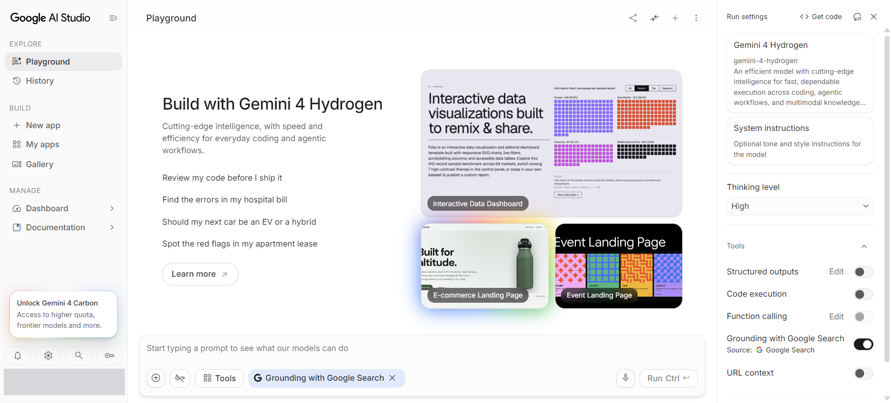
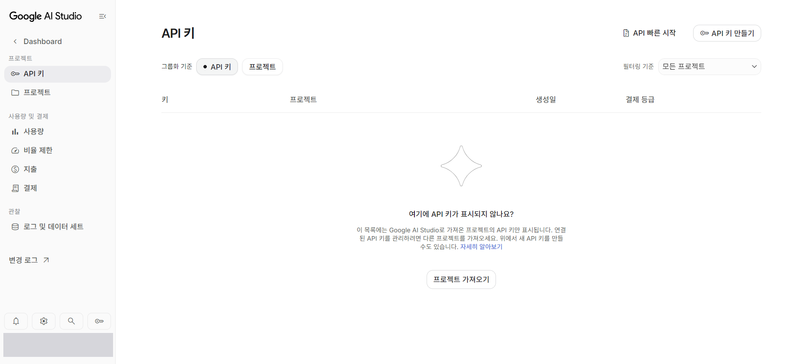
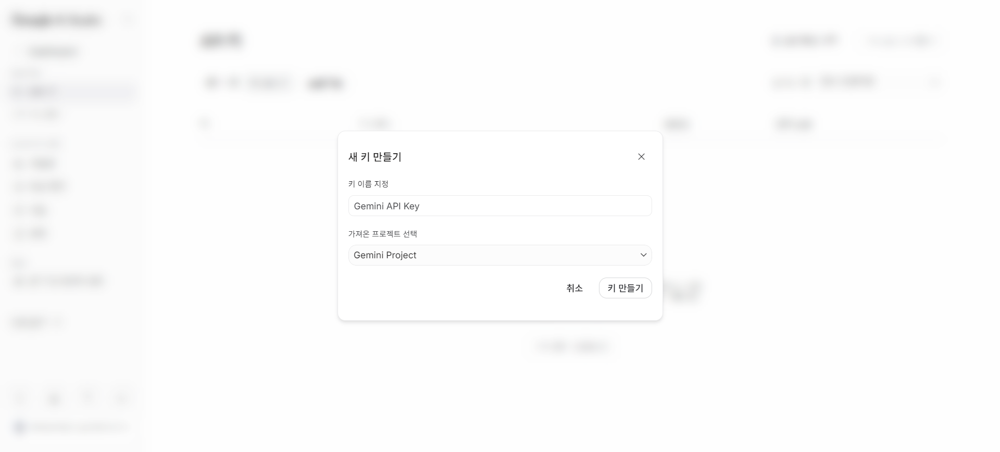
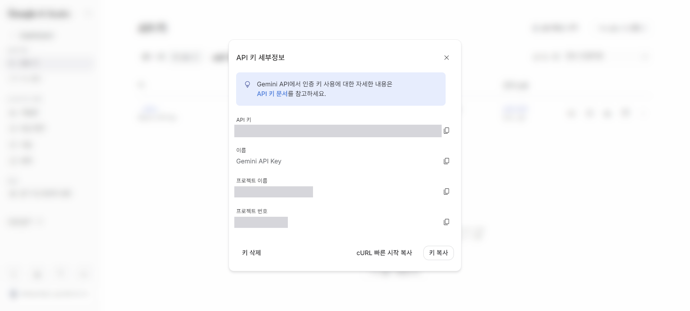
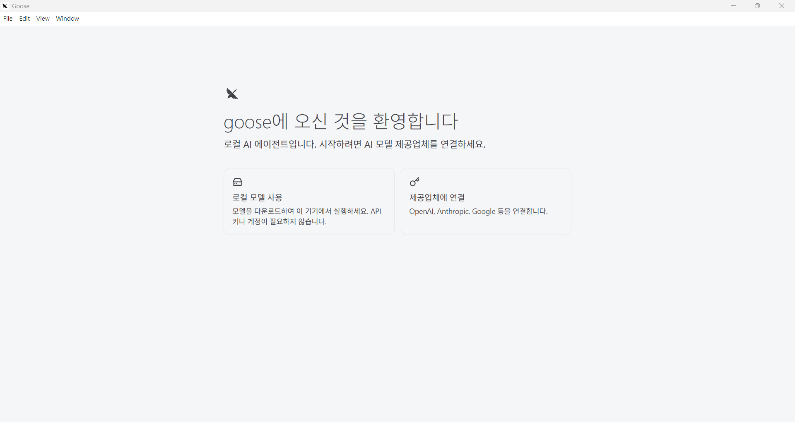
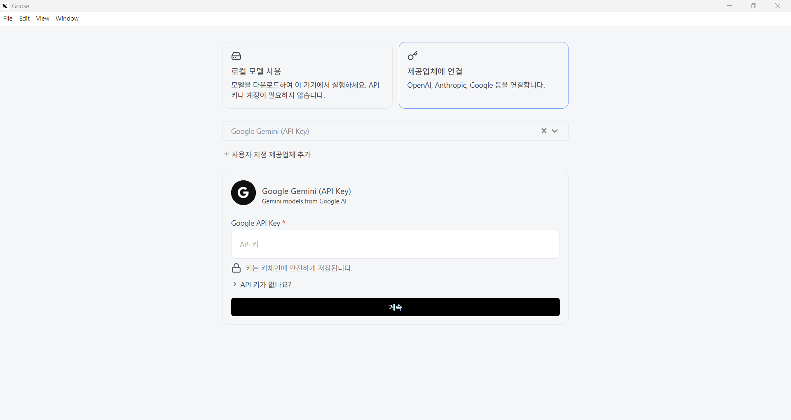
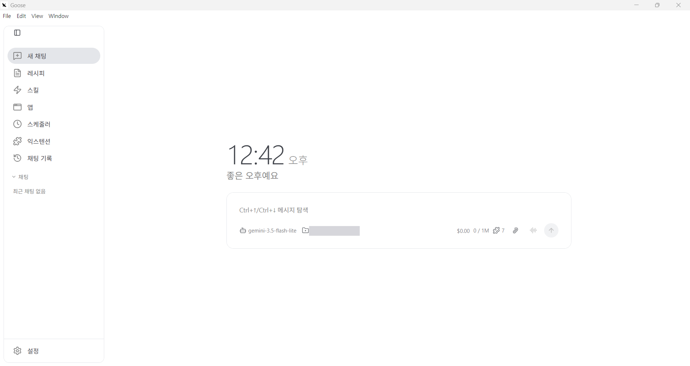
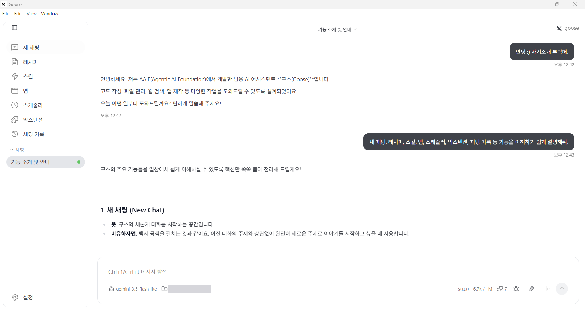

# AI 에이전트 플랫폼 개발 Hands-on

이 강의에서는 **문서 분석 및 보고서 작성 AI 에이전트**(코드 이름 `doc_report_agent`)를 만듭니다. 문서를 넣으면 에이전트가 문서를 읽고, 분석하고, 보고서를 저장하고, 웹 채팅 화면에서 그 과정을 보여 줍니다. 마지막에는 같은 뼈대로 여러분의 해커톤 아이디어를 에이전트로 옮겨 봅니다.

사용하는 기술은 Gemini API, Goose Desktop, Google ADK, MCP, AG-UI, CopilotKit입니다. 각 기술이 무엇인지는 처음 나올 때 한 문장으로 설명합니다.

이 저장소에는 두 가지 코스가 있습니다. 어느 쪽을 선택하든 이 README만 보고 따라 할 수 있습니다.

## 어떤 트랙을 선택할까요

트랙은 강의 코스의 종류입니다. 시간에 맞춰 하나를 고르세요.

| | basic | advanced |
| --- | --- | --- |
| 한 줄 설명 | 60분 핵심 요약 | 전체 과정(1일, 5시간) |
| 수준 | 초급 | 초급~중급 |
| 시간 | 60분 | 300분(모듈 275분 + 휴식·질의응답 25분, 점심 별도) |
| 구성 | SESSION 1–5 (M1–M5) | PART 1–5 (M6–M10) |
| 실습 | 3개 (L1, L2, L3) | 9개 (L4~L12) |
| 이런 분께 | 전체 흐름을 한 번 보고 가능성을 확인하고 싶은 분 | 직접 구현하고 나만의 프로토타입까지 만들고 싶은 분 |
| 슬라이드 | [basic 슬라이드](slides/hands-on-ai-agent-platform-basic.pptx) | [advanced 슬라이드](slides/hands-on-ai-agent-platform-advanced.pptx) |
| 강사용 스크립트 | [basic 스크립트](docs/instructor/basic-script.md) | [advanced 스크립트](docs/instructor/advanced-script.md) |

표에 나오는 번호는 이렇게 읽습니다.

- **M1~M10**은 모듈 번호입니다. 모듈은 강의를 나눈 한 덩어리(SESSION 또는 PART)입니다.
- **L1~L12**는 실습 번호입니다. 실습은 직접 명령을 실행해 보는 시간입니다.
- **SEC-01~SEC-12**는 보안 체크리스트 항목 번호입니다.

**basic에는 별도 코드가 없습니다.** basic의 실습 3개는 advanced의 실습 폴더를 그대로 실행합니다. 같은 폴더를 두 트랙에서 다음처럼 다르게 씁니다.

| basic 실습 | 쓰는 폴더 | advanced에서는 | basic에서 하는 일 | advanced에서 더 하는 일 |
| --- | --- | --- | --- | --- |
| L1 | `labs/01-gemini-api` | L4 | `hello_gemini.py` 하나만 실행합니다 | `list_models.py`로 모델 ID도 확인합니다 |
| L2 | `labs/04-function-tools` | L7 | `adk web`에서 완성된 에이전트를 실행하고 도구 호출을 관찰합니다 | `adk run`도 쓰고, 앞 단계(L6)에서 에이전트를 먼저 만들어 봅니다 |
| L3 | `labs/07-copilotkit-frontend` + `labs/06-agui-backend` | L9 + L10 | 서버 두 개를 켜서 브라우저에서 대화합니다 | 이벤트가 오가는 모습을 `send_run.py`로 직접 관찰(L9)한 뒤 화면(L10)을 연결합니다 |

basic을 끝낸 뒤 advanced를 이어서 한다면, 이미 한 실습은 건너뛰어도 됩니다(예: L4의 `hello_gemini.py`). 각 `labs/NN-*` 폴더는 앞 실습을 끝내지 못해도 바로 시작할 수 있도록 완성된 상태로 들어 있습니다.

## 학습 목표

- Google AI Studio에서 Gemini API 키를 발급해 환경 변수로 등록하고 Python 코드에서 Gemini 응답을 받습니다
- Goose Desktop에 Gemini 프로바이더와 모델을 설정하고 로컬 파일을 읽어 코드를 만들게 합니다
- Google ADK로 Model·Instruction·Tool을 갖춘 문서 분석 에이전트를 만들고 실행합니다
- Function Tool과 MCP 서버로 에이전트에 외부 기능을 연결합니다 (advanced 트랙)
- AG-UI와 CopilotKit으로 에이전트와 대화하는 웹 채팅 화면을 띄우고 도구 실행 상태를 표시합니다
- API 키 관리·접근 제어·프롬프트 인젝션 대응을 보안·거버넌스 체크리스트로 점검합니다
- 자신의 서비스 아이디어를 에이전트 역할·도구·화면으로 설계해 프로토타입을 만듭니다

## 대상과 사전 지식

- AI 서비스·창업 아이디어를 기획하는 해커톤 참가자
- 터미널에서 명령을 실행하고 폴더를 이동할 수 있어야 합니다. **터미널**은 글자로 명령을 입력해 컴퓨터에 일을 시키는 창입니다.
- Python 기초 문법(함수, 딕셔너리, import)을 읽을 수 있어야 합니다
- Google 계정이 있어야 합니다(Google AI Studio 로그인용)
- JavaScript/TypeScript는 읽을 수 있으면 좋습니다. 화면 코드(프론트엔드)는 완성본을 제공합니다.

## 저장소 구조

저장소는 이 강의의 파일을 모아 둔 폴더 전체입니다. 주요 파일은 다음과 같습니다.

```
README.md                          이 문서
requirements.txt  .env.example  .gitignore
data/samples/                      공통 샘플 문서(모두 가상 데이터)
labs/
  01-gemini-api/                   L1·L4  Gemini API 호출
  02-goose-devenv/                 L5     Goose 설정과 solution/doc_stats.py
  03-adk-agent/                    L6     Model + Instruction 에이전트
  04-function-tools/               L2·L7  Function Tool 3개 (read_document, analyze_document, save_report)
  05-mcp-tools/                    L8     MCP 서버(doc_mcp_server.py)와 McpToolset
  06-agui-backend/                 L3·L9  AG-UI 서버(server.py, 포트 8000)
  07-copilotkit-frontend/          L3·L10 Next.js + CopilotKit 화면(포트 3000)
  08-security-governance/          L11    가드레일(guardrails.py)과 audit.py
  09-final-project/                L12    템플릿 my_service_agent
docs/                              기획서, 사전 준비, 아키텍처, 체크리스트, 트랙별 상세 자료
slides/                            트랙별 슬라이드(PPTX)
```

- `requirements.txt`는 설치할 Python 패키지 목록입니다. 패키지는 남이 만들어 둔 프로그램 부품입니다.
- `.env.example`은 설정 파일의 견본입니다. 아래 환경 준비에서 복사해서 씁니다.

각 `labs/NN-*` 폴더에는 실습별 `README.md`가 있습니다. 이 README는 전체 진행을 안내하고, 폴더 안 README는 그 실습의 자세한 설명입니다.

## 환경 준비

두 트랙이 같습니다. **강의가 시작되기 전에 끝내 두세요.** 설치 순서와 운영체제(OS)별 안내는 [사전 준비 가이드](docs/prep-guide.md)에 더 자세히 있습니다.

### 필요한 것

| 항목 | 버전 |
| --- | --- |
| Python | 3.12 권장(3.11~3.13 허용, 3.14는 확인하지 못해 제외) |
| Node.js | 22 LTS 이상 권장(최소 20.9). 화면(Frontend)을 실행하는 데 필요합니다 |
| Git | 아무 최신판 |
| Goose Desktop | 미리 설치합니다. 설치 방법은 [Goose 설치 문서](https://goose-docs.ai/docs/getting-started/installation)를 보세요 |
| Google 계정 | Google AI Studio에서 API 키를 발급받는 데 씁니다 |
| OS | Windows, macOS |

### 0. 저장소 받기

저장소는 이 강의의 파일을 모아 둔 폴더 전체입니다. 강사가 알려 준 주소에서 저장소를 내려받거나(또는 강사가 준 ZIP 파일을 풀어) 내 컴퓨터에 `hands-on-ai-agent-platform` 폴더를 준비하세요. 터미널에서 내려받는다면 다음 한 줄을 실행합니다. `<...>` 부분은 강사가 알려 준 주소로 바꿔 입력하세요.

```
git clone <강사가 알려 준 주소>
```

이 명령은 저장소를 둘 폴더(예: 문서 폴더)에서 실행하세요. 명령을 실행한 폴더 안에 `hands-on-ai-agent-platform` 폴더가 새로 생깁니다. 그 폴더 안에 이 `README.md`가 보이면 준비된 것입니다.

### 터미널 여는 법과 저장소 최상위 폴더

이 README의 명령은 대부분 **저장소 최상위 폴더**에서 실행합니다. 저장소 최상위 폴더는 `README.md`, `labs` 폴더, `requirements.txt`가 한눈에 보이는 폴더입니다.

1. 터미널을 엽니다. Windows는 시작 메뉴에서 PowerShell을 검색해 실행하고, macOS는 Spotlight에서 터미널을 검색해 실행합니다.
2. 저장소 최상위 폴더로 이동합니다. `cd` 뒤에 폴더 경로를 적으면 그 폴더로 이동합니다.

   ```
   cd <저장소 최상위 폴더의 경로>
   ```

   `<...>` 부분은 실제 경로로 바꿔 입력하세요.

터미널을 새로 열 때마다 이 이동을 다시 해야 합니다.

### 1. 가상환경과 패키지 설치

**가상환경**은 이 강의에 필요한 패키지를 다른 프로젝트와 섞이지 않게 따로 담아 두는 폴더입니다. 먼저 가상환경을 만듭니다. 저장소 최상위 폴더의 터미널에서 실행하세요. `.venv`라는 폴더가 생깁니다.

```
python -m venv .venv
```

macOS에서 `python`을 찾을 수 없다는 오류가 나면, `python3`만 설치되어 있을 수 있습니다. 그때는 위 명령 대신 `python3 -m venv .venv`로 가상환경을 만드세요. 아래에서 가상환경을 활성화한 뒤에는 이 README의 `python` 명령을 그대로 쓸 수 있습니다. 이 방법은 macOS에서 직접 확인하지 못했습니다. 그래도 안 되면 강사에게 물어보세요.

가상환경은 만든 뒤 **활성화**해야 쓸 수 있습니다. 운영체제와 터미널 종류에 따라 명령이 다르니 하나만 실행하세요. **새 터미널을 열 때마다 다시 활성화해야 합니다.**

Windows PowerShell:

```
.venv\Scripts\Activate.ps1
```

Windows 명령 프롬프트(cmd):

```
.venv\Scripts\activate.bat
```

macOS:

```
source .venv/bin/activate
```

PowerShell에서 `이 시스템에서 스크립트를 실행할 수 없으므로`라는 오류가 나면 PowerShell이 스크립트 실행을 막아 둔 것입니다. 다음 명령을 한 번만 실행해 허용한 뒤 위의 PowerShell용 활성화 명령을 다시 입력하세요. 현재 사용자에게만 적용되는 설정입니다.

```
Set-ExecutionPolicy -Scope CurrentUser -ExecutionPolicy RemoteSigned
```

확인 질문이 나오면 `Y`를 입력하고 Enter를 누르세요.

다른 방법도 있습니다. PowerShell 대신 명령 프롬프트(cmd) 창을 **새로 열어** 위의 명령 프롬프트용 명령을 입력하세요. PowerShell 창 안에서 `activate.bat`을 실행하면 활성화되지 않으니 주의하세요.

입력줄 맨 앞에 `(.venv)`가 보이면 활성화된 것입니다. 이제 필요한 패키지를 한꺼번에 설치합니다(깨끗한 가상환경 기준 약 96초 걸렸습니다).

```
pip install -r requirements.txt
```

### 2. API 키 등록

**API 키**는 Gemini를 호출할 권한을 증명하는 비밀 문자열입니다. 비밀번호처럼 다루세요. 코드나 채팅창에 붙여 넣지 마세요.

먼저 Google AI Studio에서 키를 발급받습니다. Google AI Studio는 Gemini API 키를 발급하고 모델을 시험해 보는 Google의 웹 사이트입니다. basic과 advanced 모두 같은 키를 씁니다. 아래 화면은 사용자가 제공한 실제 화면(2026-11-15 캡처)이고, 키와 프로젝트 정보는 가려 두었습니다. 화면 언어(영어/한국어)와 모양은 계정과 시기에 따라 다를 수 있습니다.

1. 브라우저에서 https://aistudio.google.com 을 열고 Google 계정으로 로그인합니다. 첫 화면이 나옵니다.

   

2. 왼쪽 아래의 **열쇠 아이콘**을 누릅니다. 주소가 `aistudio.google.com/api-keys`인 API 키 화면으로 이동합니다.
3. 화면 오른쪽 위의 **API 키 만들기** 버튼을 누릅니다.

   

4. **새 키 만들기** 창이 열립니다. **키 이름 지정**에 알아보기 쉬운 이름(예: Gemini API Key)을 적고, **가져온 프로젝트 선택**에서 프로젝트를 고른 뒤 **키 만들기**를 누릅니다.

   

5. **API 키 세부정보** 창이 열립니다. **키 복사** 버튼을 눌러 키를 복사합니다. 이 창에는 실제로는 키가 그대로 보이지만, 아래 그림에서는 회색 상자로 가렸습니다. 남에게 보이지 않게 조심하세요.

   

6. 이제 키를 `.env` 파일에 적습니다. 견본 파일 `.env.example`을 복사해 `.env`라는 이름으로 만드세요. 저장소 최상위 폴더의 터미널에서 실행합니다.

   Windows PowerShell 또는 cmd:

   ```
   copy .env.example .env
   ```

   macOS:

   ```
   cp .env.example .env
   ```

7. 편집기(메모장 등)로 `.env`를 열어 `GOOGLE_API_KEY=` 뒤에 복사한 키를 붙여 넣고 저장하세요. 따옴표는 붙이지 않습니다. Goose Desktop에도 같은 키를 넣게 되므로(advanced의 L5, 또는 강사 시연) 키는 잠시 복사해 둔 채로 두세요.

`.env`는 설정값을 적어 두는 파일이고, 프로그램이 시작할 때 이 파일을 읽어 씁니다. **환경 변수**는 프로그램이 실행될 때 읽을 수 있는 `이름=값` 형태의 설정입니다. 이 강의에서는 `.env`에 적은 값이 그 역할을 합니다. 이 파일에는 다음 세 가지가 있습니다.

| 변수 | 기본값 | 용도 |
| --- | --- | --- |
| `GOOGLE_API_KEY` | (없음) | Gemini API 키입니다. Python 코드와 ADK가 이 이름으로 읽습니다. Goose Desktop에는 화면에서 같은 키를 입력합니다 |
| `DOC_AGENT_MODEL` | `gemini-3.5-flash-lite` | 사용할 모델의 ID입니다. 모델을 바꾸려면 이 줄만 고치세요. `mock`으로 적으면 모의 모델(뒤에서 설명)을 씁니다 |
| `ADK_AG_UI_URL` | `http://localhost:8000/ag-ui` | 화면(Frontend)이 연결할 Backend의 주소입니다 |

`.env`는 `.gitignore`에 들어 있어서 저장소에 올라가지 않습니다. 그래도 키를 코드나 채팅창에 붙여 넣지 마세요. `ADK_AG_UI_URL`은 화면 쪽 프로그램(Next.js)이 최상위 `.env`를 읽지 않기 때문에 화면에는 자동으로 적용되지 않습니다([문제 해결](#문제-해결) 참고).

### 3. Frontend 패키지 미리 설치(권장)

**Frontend**는 브라우저에 보이는 화면을 만드는 프로그램입니다. 이 강의의 Frontend는 Node.js로 실행하는 Next.js 프로그램이고, 필요한 패키지를 `npm`으로 설치합니다. 설치는 처음 한 번만 하면 되지만 약 5분(패키지 1176개) 걸렸습니다. 강의 중에 기다리지 않도록 미리 해 두세요. 저장소 최상위 폴더의 터미널에서 실행합니다.

```
npm --prefix labs/07-copilotkit-frontend install
```

### 4. 준비가 됐는지 확인

저장소 최상위 폴더의 터미널(가상환경이 활성화된 상태)에서 실행하세요.

```
python labs/01-gemini-api/check.py
```

마지막 줄이 `CHECK OK`이면 Python 환경이 준비된 것입니다. 이 확인은 키가 없어도 모의 경로로 통과합니다. 키가 제대로 동작하는지는 L1(또는 L4)에서 실제로 호출해 확인합니다.

### 키가 없거나 무료 한도에 걸렸을 때(모의 모델)

**모의 모델**은 인터넷으로 Gemini를 호출하지 않고, 미리 정해 둔 도구 호출과 답을 돌려주는 테스트용 모델입니다. 실습의 흐름(도구 호출, 이벤트 전달, 화면)을 키 없이 그대로 볼 수 있습니다.

- L1/L4: 스크립트 명령 끝에 `--mock`을 붙이세요. 예: `python labs/01-gemini-api/hello_gemini.py --mock`
- ADK와 서버를 쓰는 실습: `.env`의 `DOC_AGENT_MODEL`을 `mock`으로 바꾸세요. 바꾼 뒤에는 이미 켜 둔 서버를 껐다가 다시 켜야 합니다.
- 모의 응답은 모델이 만든 요약이 아닙니다. 문서의 첫 글머리를 그대로 보여 주는 정해진 응답입니다.
- 모든 `check.py`는 키 없이 `CHECK OK`가 나오도록 항상 모의 모델로 동작합니다. 실제 Gemini 호출까지 확인하려면 키가 있을 때 `python labs/01-gemini-api/check.py --live`만 실행하세요.

### 무료 등급 안내

- `gemini-3.5-flash-lite`는 무료 등급에서 요금이 없습니다(공식 가격표에서 확인했습니다). 다만 **무료 등급에 넣은 입력은 제품 개선에 쓰일 수 있으므로 실제 민감 문서나 개인 정보를 넣지 마세요.** 이 저장소의 `data/samples/` 문서는 모두 가상 데이터입니다.
- 분당·일일 요청 한도 숫자는 공식 문서에 표로 나와 있지 않아 이 README에 적지 않았습니다. 내 프로젝트의 한도는 https://aistudio.google.com/rate-limit 에서 확인하세요.
- 한국에서 무료 등급을 쓸 수 있는지는 확인하지 못했습니다. 키를 발급받은 뒤 L1을 미리 실행해 보세요.

### 터미널에서 환경 변수를 잠깐 정하는 법

몇몇 실습에서는 `.env` 대신, 터미널에서 환경 변수 하나를 잠깐 정한 뒤 같은 터미널에서 명령을 실행합니다. 그 터미널을 닫으면 값은 사라집니다. 예로 `PORT`를 `8001`로 정한 뒤 Backend 서버를 켜는 방법입니다. 이름과 값은 필요에 따라 바꿔 쓰세요.

Windows PowerShell:

```
$env:PORT="8001"
```

Windows 명령 프롬프트(cmd):

```
set PORT=8001
```

macOS:

```
export PORT=8001
```

위 명령을 입력한 뒤, 같은 터미널에서 서버를 켜는 명령을 이어서 입력하세요.

---

## basic

60분 핵심 요약입니다. 위의 [환경 준비](#환경-준비)를 끝낸 상태에서 시작합니다. 설치와 키 발급은 강의 중에 하지 않습니다.

| 모듈 | 시간 | 실습 |
| --- | --- | --- |
| SESSION 1. AI 에이전트 플랫폼의 이해 | 5분 | — |
| SESSION 2. Gemini API 연결 및 Goose 활용 | 10분 | L1 (4분) + Goose 시연 |
| SESSION 3. AI 에이전트 개발 | 15분 | L2 (8분) |
| SESSION 4. AG-UI를 활용한 채팅 화면 구현 | 20분 | L3 (12분) + 최종 시연 |
| SESSION 5. 보안 및 해커톤 프로젝트 적용 | 10분 | — |

세부 구성표는 [60분 강의 구성표](docs/basic/session-plan.md)에, 최종 시연에서 입력할 문장과 문제가 생겼을 때의 대체 경로는 [데모 시나리오](docs/basic/demo-scenario.md)에 있습니다. 시간이 밀리면 SESSION 4의 실습을 강사 시연으로 바꿉니다.

### SESSION 1. AI 에이전트 플랫폼의 이해

실습은 없습니다. 슬라이드를 보면서 다음 세 가지를 기억하세요.

- **LLM**(대규모 언어 모델)은 아주 많은 글을 학습해 사람의 말처럼 글을 만들어 내는 모델입니다. 질문에 답하기, 요약하기, 도구 고르기에 씁니다. 여기서는 Google의 Gemini입니다. **AI 에이전트**는 목표를 받으면 모델의 판단으로 **도구**(에이전트가 호출할 수 있는 기능)를 골라 실행하고, 그 결과를 보고 답하는 프로그램입니다.
- **API**로 모델을 빌려 쓰면 모델을 직접 만들지 않아도 서비스를 만들 수 있습니다. API는 프로그램이 다른 프로그램의 기능을 요청하는 창구입니다.
- 오늘 만들 에이전트는 네 계층으로 이루어집니다. 모델(Gemini), 에이전트(ADK), 도구(Tool·MCP), 프론트엔드(AG-UI·CopilotKit)입니다. 전체 그림은 [아키텍처 문서](docs/architecture.md)에 있습니다.

### SESSION 2. Gemini API 연결 및 Goose 활용

#### 실습 L1: Gemini API 연결 확인 (`labs/01-gemini-api`)

목표: 발급받은 API 키로 Gemini에 문서 요약을 요청하고 응답을 받습니다.

시작 전에 확인하세요. 저장소 최상위 폴더에서 터미널을 열었고, 가상환경이 활성화되어 있으며(`(.venv)` 표시), `.env`에 키를 적어 두었어야 합니다.

1. 터미널에서 다음 명령을 실행해 Gemini에 요약을 요청합니다.

   ```
   python labs/01-gemini-api/hello_gemini.py
   ```

2. 터미널에 다음이 출력되면 성공입니다.
   - `모델 ID: gemini-3.5-flash-lite (Interactions API)`
   - `문서: data/samples/project_status_report.md`
   - `요약:` 아래에 3줄 요약

3. 이어서 자동 확인을 실행합니다.

   ```
   python labs/01-gemini-api/check.py
   ```

   마지막 줄이 `CHECK OK`이면 끝입니다.

키가 없다면 1번 대신 `python labs/01-gemini-api/hello_gemini.py --mock`을 실행하세요. `모델 ID: gemini-3.5-flash-lite (모의 응답, API 호출 없음)`과 문서의 첫 글머리 3줄이 나오면 됩니다.

막힐 때:

| 화면에 보이는 증상 | 원인과 해결 |
| --- | --- |
| `GOOGLE_API_KEY가 없습니다` (종료 코드 2) | `.env`가 저장소 최상위 폴더에 없거나 키 줄이 비어 있습니다. 파일 위치와 키를 확인하세요 |
| `Gemini API 오류 429` | 무료 등급의 사용량 제한에 걸렸습니다. 잠시 뒤에 다시 하거나 AI Studio에서 한도를 확인하세요 |
| `Gemini API 오류 404` | 모델 ID가 틀렸습니다. `.env`의 `DOC_AGENT_MODEL`을 확인하세요 |
| `ModuleNotFoundError: google` | 가상환경을 활성화하지 않았습니다. 활성화 명령을 다시 실행하세요 |

#### Goose 시연 (강사)

실습 번호가 없는 시연입니다. 강사가 Goose Desktop에 Gemini를 연결하고, 샘플 문서를 읽게 해서 코드를 만드는 모습을 보여 줍니다. **Goose Desktop**은 컴퓨터에 설치해서 쓰는 오픈소스 AI 에이전트 프로그램입니다. 연결 화면은 advanced 트랙의 PART 1에 있는 실습 L5에 그림과 함께 있습니다. 직접 해 보고 싶다면 그 절을 따라 하세요. 사전 준비 가이드([docs/prep-guide.md](docs/prep-guide.md))에서도 미리 연결해 볼 수 있습니다.

### SESSION 3. AI 에이전트 개발

핵심은 다음과 같습니다.

- **Google ADK**(Agent Development Kit)는 에이전트를 코드로 만들고 실행하게 해 주는 Google의 프레임워크입니다. 프레임워크는 자주 필요한 기능을 미리 만들어 둔 뼈대입니다. ADK 에이전트는 Model(모델), Instruction(역할과 규칙을 적은 지시문), Tool(도구)로 구성하고, `root_agent`라는 변수 하나로 시작합니다.
- Python 함수에 타입 힌트(인자와 결과의 종류 표기)와 docstring(함수 바로 아래에 적는 설명 글)을 쓰면 **Function Tool**이 됩니다. 모델은 이 설명을 보고 도구를 고릅니다.
- **MCP**(Model Context Protocol)는 에이전트에 외부 도구를 표준 방식으로 연결하는 약속입니다. basic에서는 개념만 소개하고, 실습은 advanced의 L8에서 합니다.

강의 중에 `labs/04-function-tools/doc_report_agent/agent.py`를 함께 읽습니다.

#### 실습 L2: ADK 문서 분석 에이전트 실행 (`labs/04-function-tools`)

목표: ADK 개발 UI(브라우저에서 에이전트를 시험하는 화면)에서 문서 분석 에이전트에게 샘플 문서를 분석·요약하고 보고서를 쓰게 한 뒤, 도구 호출을 확인합니다.

이 실습은 서버를 켜 두고 브라우저를 씁니다. **서버**는 요청을 기다렸다가 응답하는 프로그램입니다. 서버가 켜져 있는 동안 그 터미널에는 새 명령을 입력할 수 없습니다.

1. 저장소 최상위 폴더의 터미널(가상환경 활성화)에서 다음 명령으로 서버를 켭니다.

   ```
   adk web --port 8080 labs/04-function-tools
   ```

   **포트**는 한 컴퓨터에서 프로그램마다 통신에 쓰는 번호입니다. 같은 번호를 두 프로그램이 동시에 쓸 수 없습니다. 여기서는 8080번을 씁니다.

2. 처음 실행하면 `Enable telemetry? [Y/n]`이라고 물을 수 있습니다. 사용 통계를 보낼지 묻는 질문이고, 기본값은 꺼짐입니다. 어느 쪽을 골라도 실습에는 영향이 없습니다.
3. 브라우저 주소창에 http://localhost:8080 을 입력해 엽니다. `localhost`는 내 컴퓨터 자신을 가리키는 주소입니다. 화면의 에이전트 목록에서 `doc_report_agent`를 고르세요.
4. 입력창에 `샘플 보고서를 분석해 줘`라고 입력합니다.
5. 다음이 보이면 성공입니다.
   - 이벤트 패널에 `read_document` -> `analyze_document` -> `save_report` 순서로 도구 호출이 나타납니다.
   - 요약·핵심 항목·문제점이 담긴 답이 나옵니다.
   - `보고서를 outputs/<날짜-시각>_스마트_배송_앱_프로젝트_주간_현황_보고.md에 저장했습니다.`라는 문장이 나옵니다.
6. 서버를 켠 터미널에서 Ctrl+C를 눌러 서버를 끕니다.
7. 같은 터미널에서 자동 확인을 실행합니다.

   ```
   python labs/04-function-tools/check.py
   ```

   `도구 호출 순서: read_document -> analyze_document -> save_report`와 `CHECK OK`가 나오면 끝입니다.

`.env`의 `DOC_AGENT_MODEL`이 `gemini-3.5-flash-lite`이고 키가 있으면 실제 Gemini가 도구를 고릅니다. 모의 모델이면 정해진 순서로 도구를 호출합니다.

막힐 때:

| 화면에 보이는 증상 | 원인과 해결 |
| --- | --- |
| `adk`를 찾을 수 없다는 오류 | 가상환경을 활성화하지 않았습니다. 활성화 명령을 실행하세요 |
| 8080 포트가 이미 사용 중이라는 오류 | 다른 `adk web`이 켜져 있습니다. 그 서버를 끄거나 `--port` 번호를 바꾸세요 |
| 브라우저의 에이전트 목록이 비어 있음 | 명령 끝의 폴더 경로가 `labs/04-function-tools`(에이전트 폴더의 상위 폴더)인지 확인하세요 |

### SESSION 4. AG-UI를 활용한 채팅 화면 구현

핵심은 다음과 같습니다.

- 에이전트는 **Backend**(눈에 보이지 않는 곳에서 에이전트를 실행하는 서버 프로그램, Python, 8000번 포트)에서 돌아갑니다. 화면은 **Frontend**(브라우저에 보이는 화면을 만드는 프로그램, Next.js, 3000번 포트)가 만듭니다.
- **AG-UI**는 에이전트(Backend)와 화면(Frontend)이 주고받는 메시지의 형식과 순서를 정한 약속(프로토콜)입니다. 화면이 실행을 요청하면 Backend가 **이벤트**(실행 시작, 글자 조각, 도구 호출, 실행 종료 같은 작은 알림 메시지)를 차례로 흘려 보냅니다.
- **CopilotKit**은 AG-UI 이벤트를 받아 채팅 화면으로 그려 주는 프론트엔드 프레임워크입니다.

#### 실습 L3: 브라우저 채팅 화면 연결 (`labs/07-copilotkit-frontend`)

목표: AG-UI Backend와 CopilotKit Frontend를 켜서 브라우저에서 문서 분석 에이전트와 대화합니다. 이 실습은 `labs/06-agui-backend`의 서버를 함께 씁니다.

**터미널 두 개**가 필요합니다. 두 터미널 모두 저장소 최상위 폴더에서 열어야 합니다. 터미널 1에서는 Python을 쓰므로 가상환경을 활성화하세요. 터미널 2는 `npm`만 쓰므로 가상환경이 필요 없습니다. 서버를 켜면 그 터미널은 서버가 쓰고 있으니, 다른 명령은 새 터미널에서 입력합니다.

1. 터미널 1에서 Backend 서버를 켭니다. 이 터미널은 그대로 켜 두세요.

   ```
   python labs/06-agui-backend/server.py
   ```

2. 새로 연 터미널 2에서 Frontend 패키지를 설치합니다. 사전 준비에서 이미 했다면 금방 끝납니다.

   ```
   npm --prefix labs/07-copilotkit-frontend install
   ```

3. 같은 터미널 2에서 Frontend 서버를 켭니다. 이 터미널도 켜 두세요.

   ```
   npm --prefix labs/07-copilotkit-frontend run dev
   ```

4. 브라우저 주소창에 http://localhost:3000 을 입력해 엽니다. 채팅창에 `샘플 보고서를 분석해 줘`를 입력하세요. 또는 `data/samples/meeting_notes.md` 파일의 내용을 복사해서 붙여 넣어도 됩니다.
5. 다음이 보이면 성공입니다.
   - 답이 한꺼번에 나오지 않고 조각 단위로 흘러나옵니다(스트리밍).
   - 도구 상태 카드가 나옵니다. `meeting_notes.md`를 붙여 넣었다면 `analyze_document 완료 핵심 항목 5개, 문제점 3개`와 `save_report 완료 저장: outputs/...md`가 보입니다. `샘플 보고서를 분석해 줘`를 입력했다면 같은 카드가 `핵심 항목 5개, 문제점 6개`로 나옵니다.
   - 오른쪽 '보고서 결과' 패널에 제목·핵심 항목·문제점·저장 경로가 표시됩니다.
6. 자동 확인을 실행합니다. 새 터미널(저장소 최상위 폴더, 가상환경 활성화)을 열어 입력하세요. 켜 둔 서버는 그대로 두어도 됩니다. 자동 확인이 비어 있는 포트에 자기 서버를 따로 켜기 때문입니다.

   ```
   python labs/07-copilotkit-frontend/check.py
   ```

   정적 검사와 Backend 왕복 확인이 끝나고 `CHECK OK`가 나오면 끝입니다.

실습을 마치면 두 터미널에서 각각 Ctrl+C를 눌러 서버를 끕니다.

막힐 때:

| 화면에 보이는 증상 | 원인과 해결 |
| --- | --- |
| 채팅을 보내도 답이 없음 | 터미널 1의 Backend가 꺼져 있습니다. 터미널 1을 확인하고 다시 켜세요 |
| `[Errno 10048]` 또는 `address already in use` | 8000번 포트를 다른 프로그램이 쓰고 있습니다. 그 프로그램을 끄거나 `PORT` 환경 변수로 포트를 바꾸세요(방법은 [터미널에서 환경 변수를 잠깐 정하는 법](#터미널에서-환경-변수를-잠깐-정하는-법) 참고). 포트를 바꾸면 Frontend의 `ADK_AG_UI_URL`도 새 주소(예: `http://localhost:8001/ag-ui`)로 맞춰야 합니다. Frontend를 켜기 전에 터미널 2에서 같은 방법으로 `ADK_AG_UI_URL` 환경 변수를 정하세요 |
| `npm`이 Node 버전 오류를 냄 | Node.js 20.9 이상(22 LTS 권장)이 필요합니다 |
| 3000번 포트가 사용 중이라는 안내 | `npm --prefix labs/07-copilotkit-frontend run dev -- --port 3001`로 다른 번호를 쓰세요 |
| 화면 문구가 영어임 | CopilotKit의 기본 문구입니다. 입력창 안내 문구만 한국어로 바꿔 두었습니다 |

### SESSION 5. 보안 및 해커톤 프로젝트 적용

실습은 없습니다. 보안 체크리스트 12개 중 핵심 6개를 봅니다(전체는 [보안·거버넌스 체크리스트](docs/security-checklist.md)에 있습니다).

- SEC-01 키는 `.env`에만 두고, 저장소에는 `.env.example`만 둡니다
- SEC-03 브라우저에 키를 두지 않고 Backend를 거쳐 호출합니다
- SEC-05 에이전트가 읽고 쓰는 폴더를 `data/`, `outputs/`로 제한합니다
- SEC-06 MCP 도구는 필요한 것만 열고, 위험한 도구는 실행 전에 사용자 승인을 받습니다
- SEC-07 문서 내용은 지시가 아니라 데이터로 다룹니다
- SEC-09 무료 등급에 넣은 입력은 제품 개선에 쓰일 수 있으므로 민감한 정보를 넣지 않습니다

그다음 내 아이디어를 **역할(Instruction) + 도구(Tool) + 화면(AG-UI)** 세 칸으로 옮겨 봅니다. 더 해 보고 싶다면 [해커톤 서비스 확장 가이드](docs/hackathon-extension-guide.md)와 아래의 advanced 트랙을 보세요.

---

## advanced

전체 과정(1일, 300분)입니다. 09:00–12:00, 13:00–15:00에 진행하고 점심(12:00–13:00)은 300분에 넣지 않습니다. 위의 [환경 준비](#환경-준비)를 끝낸 상태에서 시작합니다. 각 실습 폴더는 완성된 상태로 들어 있어서 앞 실습을 끝내지 못해도 바로 시작할 수 있습니다. 자세한 목차와 시간표는 [advanced 커리큘럼](docs/advanced/curriculum.md)에, PART별 상세 자료는 [PART 1](docs/advanced/part-1.md), [PART 2](docs/advanced/part-2.md), [PART 3](docs/advanced/part-3.md), [PART 4](docs/advanced/part-4.md), [PART 5](docs/advanced/part-5.md)에 있습니다.

| 모듈 | 시간 | 실습 |
| --- | --- | --- |
| PART 1. LLM API 및 AI 에이전트 개발 환경 구축 | 60분 | L4 (15분), L5 (20분) |
| PART 2. Google ADK 기반 AI 에이전트 개발 | 100분 | L6 (15분), L7 (25분), L8 (20분) |
| PART 3. AG-UI 기반 사용자 인터페이스 개발 | 60분 | L9 (15분), L10 (25분) |
| PART 4. AI 에이전트 보안 및 거버넌스 | 25분 | L11 (15분) |
| PART 5. 나만의 AI 에이전트 프로토타입 | 30분 | L12 (20분) |

모듈 시간을 모두 더하면 275분이고, 휴식과 질의응답 25분을 더해 300분입니다. 시간 안에 다 하지 못한 부분(각 PART의 '실습 확장'과 PART 5 확장판)은 강의 뒤에 이어서 하면 됩니다.

기술을 고른 근거와 출처는 [기술 검증 결과](docs/tech-verification.md)에 있습니다.

### 하루 시간표(300분)

| 시간 | 내용 |
| --- | --- |
| 09:00–10:00 | PART 1 (60분): 시작 10분(과정 소개·시간표·AI 에이전트란 무엇인가·사전 준비) + 본문 50분(L4 15분, L5 20분 포함) |
| 10:00–10:10 | 휴식 |
| 10:10–11:50 | PART 2 (100분): L6 15분, L7 25분, L8 20분 (중간에 5분 휴식 포함) |
| 11:50–12:00 | 질의응답 (오전이 밀리면 예비 시간으로 씁니다) |
| 12:00–13:00 | 점심 (300분에 포함하지 않음) |
| 13:00–14:00 | PART 3 (60분): L9 15분, L10 25분 |
| 14:00–14:05 | 휴식 |
| 14:05–14:30 | PART 4 (25분): L11 15분 |
| 14:30–15:00 | PART 5 (30분): 안내 3분, L12 20분, 발표 4분, 정리 3분 |

설치는 강의 시간에 넣지 않았습니다. `pip install`과 `npm install`은 강의 전에 끝내 주세요. 키 발급은 가능하면 강의 전에 끝내고, 못 했다면 실습 L4에서 키 발급 화면을 따라 하거나 `--mock`으로 진행합니다([환경 준비](#환경-준비), [사전 준비 가이드](docs/prep-guide.md)).

### AI 에이전트란 무엇인가

PART 1을 시작하기 전에 알아 둘 개념입니다. 같은 내용이 advanced 슬라이드 4~6번에 있습니다.

- **LLM은 답하고, 에이전트는 일합니다.** LLM(대규모 언어 모델)은 질문에 글로 답합니다. 에이전트는 목표를 받으면 스스로 계획을 세우고 도구를 써서 일을 끝냅니다.
- **에이전트는 다섯 요소로 이루어집니다.** 모델, 메모리(Context), 에이전트, 도구(Tool), 데이터입니다. 메모리는 대화와 작업 중에 기억해 두는 내용이고, 데이터는 에이전트가 도구로 읽고 쓰는 문서 같은 바깥의 정보입니다.
- **에이전트는 루프를 돕니다.** 목표 → 계획 → 도구 실행 → 결과 반영 → 답변 순서로 진행하고, ④ 결과 반영 뒤에 결과를 보고 ② 계획으로 돌아가 다시 판단하며 반복합니다. 목표를 이루면 ⑤ 답변으로 끝납니다.
- **도구는 에이전트가 바깥 세상에 닿는 유일한 통로입니다.** 모델은 글만 만들 수 있으므로 파일을 읽고 쓰거나 계산하는 일은 도구가 대신합니다. 그래서 이 과정에서는 도구를 만들고 연결하는 데 대부분의 시간을 씁니다.

### PART 1. LLM API 및 AI 에이전트 개발 환경 구축

핵심: 모델은 API로 빌려 쓰고, 개발 환경(Goose)도 같은 키로 연결합니다. Gemini를 호출하는 방법으로는 Interactions API와 `generateContent`가 있습니다. Interactions API는 새 프로젝트에 권장되는 방식이고, 기존 `generateContent`도 계속 지원됩니다(옛 방식이라 '레거시'라고 부릅니다).

#### 실습 L4: Gemini API 첫 호출 (`labs/01-gemini-api`)

목표: google-genai SDK(Python에서 Gemini를 부르는 공식 부품)로 모델 목록에서 `gemini-3.5-flash-lite`를 확인하고, 샘플 문서 요약을 요청합니다.

시작 전에 확인하세요. 저장소 최상위 폴더의 터미널에서 가상환경이 활성화되어 있고 `.env`에 키가 있어야 합니다.

1. 모델 ID를 실제로 쓸 수 있는지 목록에서 확인합니다.

   ```
   python labs/01-gemini-api/list_models.py
   ```

   flash-lite 계열 모델 목록과 `gemini-3.5-flash-lite: available`이 출력됩니다.

2. 문서 요약을 요청합니다.

   ```
   python labs/01-gemini-api/hello_gemini.py
   ```

   `모델 ID: gemini-3.5-flash-lite (Interactions API)`와 3줄 요약이 나옵니다.

3. (선택) 옛 방식(`generateContent`)으로 같은 요청을 보내 봅니다. 명령은 `python labs/01-gemini-api/hello_gemini.py --legacy`입니다.
4. 자동 확인을 실행합니다.

   ```
   python labs/01-gemini-api/check.py
   ```

   마지막 줄이 `CHECK OK`입니다.

키가 없다면 각 스크립트 끝에 `--mock`을 붙이세요(`list_models.py --mock`, `hello_gemini.py --mock`). 막힐 때 표는 basic의 L1과 같습니다(429는 무료 한도, 404는 모델 ID 오타). 모델 ID를 바꾸려면 `.env`의 `DOC_AGENT_MODEL`만 고치세요. 검증된 대체 후보는 `gemini-3.1-flash-lite`, `gemini-2.5-flash-lite`입니다.

#### 실습 L5: Goose로 문서 통계 도구 만들기 (`labs/02-goose-devenv`)

목표: Goose Desktop에 Gemini를 연결하고, Goose에게 샘플 문서를 읽게 해서 문서 통계 스크립트(`doc_stats.py`)를 만들고 실행하게 합니다. **프로바이더**는 Goose가 연결해서 쓰는 AI 모델 서비스(여기서는 Google Gemini)입니다. Goose는 화면(GUI)으로 쓰는 프로그램이라 자동 검증을 할 수 없습니다.

아래 그림은 사용자가 제공한 실제 Goose Desktop 화면(2026-11-15 캡처)입니다. 연결과 한국어 대화까지는 이 화면으로 확인했습니다. Goose가 `doc_stats.py`를 만드는 과정은 확인하지 못했습니다. 화면에 보이는 이름(버튼, 메뉴)을 그대로 따라 하세요.

1~4번은 터미널이 아니라 Goose Desktop 창에서 합니다. 앞에서 복사해 둔 API 키가 필요합니다.

1. Goose Desktop을 처음 실행하면 "goose에 오신 것을 환영합니다" 화면이 나옵니다. **로컬 모델 사용**과 **제공업체에 연결** 중에서 **제공업체에 연결**을 누릅니다.

   

2. 목록에서 **Google Gemini (API Key)**를 고르고, **Google API Key** 칸에 API 키(`GOOGLE_API_KEY`와 같은 값)를 붙여 넣은 뒤 **계속**을 누릅니다. 화면에 "키는 키체인에 안전하게 저장됩니다"라고 나옵니다. 키체인은 운영체제가 비밀 값을 보관하는 곳입니다.

   

3. 키를 연결한 뒤 모델로 `gemini-3.5-flash-lite`를 선택하세요. 모델을 고르는 화면은 이 README에 그림이 없습니다. 선택이 끝나면 채팅 화면이 나오고, 입력창 아래에 모델 이름 `gemini-3.5-flash-lite`와 작업 폴더가 보입니다.

   

4. 입력창에 한국어로 말을 걸어 답이 오는지 확인합니다. 예를 들어 `안녕 :) 자기소개 부탁해.`라고 입력해 보세요. 답이 오면 연결이 된 것입니다.

   

   작업 폴더가 이 저장소의 최상위 폴더가 아니라면 최상위 폴더로 바꿔 두세요. Developer 확장(파일 편집과 터미널 명령 실행을 맡는 Goose의 기본 기능)이 켜져 있어야 합니다. 설치할 때 기본으로 켜져 있습니다.

이미 다른 설정으로 Goose를 쓰고 있었거나, 모델 목록에 `gemini-3.5-flash-lite`가 보이지 않을 때는 다음 방법을 쓰세요. 이 방법은 Goose 공식 문서(https://goose-docs.ai/docs/getting-started/providers)에서 확인한 것이고, 화면으로는 확인하지 못했습니다. 화면 이름은 영어로 적혀 있으며 한국어 화면에서는 다르게 보일 수 있습니다(예: 왼쪽 아래의 설정).

- 사이드바에서 **Settings** → **Models** → **Configure providers**를 누르고 **Google Gemini**를 고른 뒤 API 키를 넣고 **Submit**을 누릅니다.
- **Switch models** → Google Gemini → **Use custom model**을 고르고 `gemini-3.5-flash-lite`를 입력한 뒤 **Select model**을 누릅니다.

5. (선택) Goose에게 맥락을 알려 주는 파일을 복사합니다. 저장소 최상위 폴더의 터미널에서 실행하세요. macOS는 `cp labs/02-goose-devenv/.goosehints .goosehints`, Windows는 `copy labs\02-goose-devenv\.goosehints .goosehints`입니다.
6. `labs/02-goose-devenv/goose_prompts.md`를 열어 프롬프트(Goose에게 시킬 말)를 차례대로 Goose의 입력창에 붙여 넣습니다. Goose가 파일을 만들거나 명령을 실행하기 전에 무엇을 하려는지 읽고 확인하세요.
7. Goose가 labs/02-goose-devenv 폴더에 `doc_stats.py`를 만들면, 저장소 최상위 폴더의 터미널에서 실행합니다.

   ```
   python labs/02-goose-devenv/doc_stats.py data/samples/project_status_report.md
   ```

   완성본 기준으로 글자 수, 단어 수, 제목(#) 목록, 키워드 수가 나옵니다. 값은 `글자 수: 519`, `단어 수: 144`, `TODO: 2`, `위험: 3`, `지연: 3`입니다.

8. 자동 확인을 실행합니다.

   ```
   python labs/02-goose-devenv/check.py
   ```

   `doc_stats.py`가 없으면 `labs/02-goose-devenv/solution/doc_stats.py`(완성본)를 대신 검사하고 `CHECK OK`를 출력합니다.

막힐 때:

- Goose가 만든 파일의 출력이 조금 다를 수 있습니다. `check.py`가 빠진 항목을 알려 주니 Goose에게 그 항목을 추가해 달라고 하세요. 그래도 막히면 `labs/02-goose-devenv/solution/doc_stats.py`와 비교해 보세요.
- 프로바이더는 화면에 **Google Gemini (API Key)**로 표시되는 항목을 고르세요. 명령줄에서 쓰는 `goose configure`는 직접 입력한 모델 이름을 받지 않는다고 공식 문서에 나와 있으므로 Goose Desktop에서 설정하세요.
- Goose는 터미널 명령을 실행할 수 있습니다. 실행하기 전에 사용자에게 확인을 받을지는 Goose 설정의 권한 모드에서 정합니다. 실습 중에는 명령을 직접 확인하는 모드를 권장합니다(SEC-06). Goose의 기본 권한 모드가 무엇인지는 확인하지 못했습니다(제공받은 화면에 권한 모드 설정은 나오지 않았습니다).

### PART 2. Google ADK 기반 AI 에이전트 개발

핵심: 프레임워크가 도구 호출 반복과 대화 기록(세션) 관리를 맡아 주므로, 여러분은 Instruction과 Tool에 집중하면 됩니다. `adk web`은 개발용 화면이며 실제 서비스 배포용이 아닙니다.

#### 실습 L6: 첫 ADK 에이전트 (`labs/03-adk-agent`)

목표: Model과 Instruction만 가진 doc_report_agent를 실행하고 `adk run`으로 터미널에서 대화합니다.

시작 전에 확인하세요. 저장소 최상위 폴더의 터미널에서 가상환경이 활성화되어 있어야 합니다.

1. `labs/03-adk-agent/doc_report_agent/agent.py`를 편집기로 열어 Model, Instruction, `root_agent`를 찾아 보세요.
2. 터미널에서 에이전트를 실행합니다. 에이전트 파일이 아니라 에이전트 **폴더**를 지정합니다.

   ```
   adk run labs/03-adk-agent/doc_report_agent
   ```

3. 처음 실행하면 `Enable telemetry? [Y/n]`이라고 물을 수 있습니다. 어느 쪽을 골라도 괜찮습니다. `[user]:`라는 입력 표시가 나오면 `data/samples/meeting_notes.md`의 내용을 복사해서 붙여 넣고 Enter를 누르세요.
4. 답이 `## 요약`, `## 핵심 항목`, `## 문제점`, `## 보고서` 형식으로 나오면 성공입니다. 끝낼 때는 `exit`를 입력하거나 Ctrl+C를 누릅니다.
5. `agent.py`의 Instruction을 바꿔(예: 답변 형식을 표로) 다시 실행해 보세요.
6. 자동 확인을 실행합니다.

   ```
   python labs/03-adk-agent/check.py
   ```

   마지막 줄이 `CHECK OK`입니다.

참고: 한 번만 묻고 끝내려면 `adk run labs/03-adk-agent/doc_report_agent "<메시지>"` 형식도 쓸 수 있습니다. `adk run`은 에이전트 폴더 안에 `.adk/session.db`(대화 기록 파일)를 만들며, 이 파일은 `.gitignore`에 들어 있습니다. `root_agent` 변수 이름을 바꾸면 ADK가 에이전트를 찾지 못합니다.

#### 실습 L7: 문서 분석 Function Tool (`labs/04-function-tools`)

목표: read_document, analyze_document, save_report 세 Function Tool을 붙여, 파일을 읽고 분석하고 보고서를 저장하게 합니다. 이 폴더는 basic의 L2와 같습니다.

시작 전에 확인하세요. 저장소 최상위 폴더의 터미널에서 가상환경이 활성화되어 있어야 합니다.

1. 도구 코드를 읽어 보세요: `labs/04-function-tools/doc_report_agent/tools.py`. 각 함수의 타입 힌트와 docstring이 모델이 보는 도구 설명이 됩니다. `read_document`는 `data/` 안의 `.md`, `.txt` 파일만 읽습니다.
2. 터미널에서 에이전트와 대화합니다.

   ```
   adk run labs/04-function-tools/doc_report_agent
   ```

   끝낼 때는 `exit`를 입력하거나 Ctrl+C를 누르세요.

3. 이번에는 개발 UI로 실행합니다. 서버가 켜지면 그 터미널은 서버가 쓰므로 둔 채로 브라우저를 엽니다.

   ```
   adk web --port 8080 labs/04-function-tools
   ```

   브라우저에서 http://localhost:8080 을 열고 `doc_report_agent`를 고른 뒤 `샘플 보고서를 분석해 줘`를 입력하세요. 이벤트 패널에 도구 호출 순서가 보입니다. 보고서는 `outputs/<날짜-시각>_<제목>.md`로 저장됩니다. 다 봤으면 서버 터미널에서 Ctrl+C로 서버를 끕니다.

4. 자동 확인을 실행합니다.

   ```
   python labs/04-function-tools/check.py
   ```

   `도구 호출 순서: read_document -> analyze_document -> save_report`와 `CHECK OK`가 나옵니다.

막힐 때: 도구 함수에 docstring이나 타입 힌트가 없으면 모델이 도구를 제대로 고르지 못합니다. 문서 경로는 `data/` 기준 상대 경로(예: `samples/project_status_report.md`)로 적습니다. `adk web`에는 항상 `--port 8080`을 붙여서 Backend의 8000번 포트와 겹치지 않게 합니다.

#### 실습 L8: MCP 서버로 문서 도구 연결 (`labs/05-mcp-tools`)

목표: 문서 목록·읽기 기능을 Python MCP 서버(stdio)로 분리하고 ADK McpToolset으로 연결합니다. **MCP 서버**는 도구를 MCP 방식으로 제공하는 프로그램입니다. **stdio**(표준 입출력)는 프로그램이 글자를 읽고 쓰는 기본 통로입니다. 에이전트가 MCP 서버를 보조 프로그램으로 직접 띄우고 이 통로로 메시지를 주고받으므로, 서버를 따로 켤 필요가 없습니다. **McpToolset**은 MCP 서버의 도구를 ADK 에이전트의 도구로 가져오는 ADK의 클래스입니다.

시작 전에 확인하세요. 저장소 최상위 폴더의 터미널에서 가상환경이 활성화되어 있어야 합니다.

1. MCP 서버가 어떤 도구를 제공하는지 직접 확인합니다.

   ```
   python labs/05-mcp-tools/inspect_mcp.py
   ```

   `MCP 서버 도구 목록:` 아래에 `list_documents`, `read_document`가 나옵니다. 이어서 `read_document 결과: success, 첫 줄 = # 해커톤 팀 킥오프 회의록`과 `data/ 밖 요청: error, ...`가 출력됩니다.

2. 에이전트에서 MCP 도구를 사용해 봅니다. 서버가 켜지면 그 터미널은 서버가 쓰므로 둔 채로 브라우저를 엽니다.

   ```
   adk web --port 8080 labs/05-mcp-tools
   ```

   브라우저에서 http://localhost:8080 을 열고 `doc_report_agent`를 고른 뒤 `샘플 문서를 분석해 줘`를 입력하세요. `list_documents` -> `read_document`(MCP 도구) -> `analyze_document` -> `save_report` 순서로 호출됩니다(모의 모델 기준). 다 봤으면 서버 터미널에서 Ctrl+C로 서버를 끕니다.

3. 자동 확인을 실행합니다.

   ```
   python labs/05-mcp-tools/check.py
   ```

   마지막 줄이 `CHECK OK`입니다.

참고: MCP에서 ADK 에이전트는 호스트(도구를 쓰는 쪽), `McpToolset`은 클라이언트(서버에 요청을 보내는 부분), `doc_mcp_server.py`는 서버입니다. 서버는 에이전트가 따로 실행하는 보조 프로그램으로 띄우고 표준 입출력으로 대화합니다. 그래서 서버 코드에서 `print`를 쓰면 대화가 깨집니다. `McpToolset`이 서버를 실행할 때는 가상환경의 Python을 쓰도록 `sys.executable`을 사용합니다. MCP Python SDK 2.x의 서버 클래스 이름은 `MCPServer`입니다(예전 이름인 `FastMCP`로 import하면 실패합니다).

### PART 3. AG-UI 기반 사용자 인터페이스 개발

핵심: AG-UI 이벤트만 맞추면 어떤 에이전트든 같은 화면에 붙일 수 있습니다. AG-UI(에이전트와 사용자 화면 사이), MCP(에이전트와 도구 사이), A2A(에이전트와 에이전트 사이)는 연결하는 대상이 서로 다릅니다. 브라우저가 Gemini를 직접 부르지 않고 Backend를 거치게 해서 키가 노출되지 않게 합니다(SEC-03).

#### 실습 L9: ADK 에이전트를 AG-UI로 노출 (`labs/06-agui-backend`)

목표: ag-ui-adk(ADK 에이전트를 AG-UI 방식으로 열어 주는 Python 패키지)로 doc_report_agent를 http://localhost:8000/ag-ui 주소로 열고, 이벤트가 오가는 모습을 직접 관찰합니다. 터미널 두 개가 필요합니다. 두 터미널 모두 저장소 최상위 폴더에서 열고 가상환경을 활성화하세요.

1. 터미널 1에서 서버를 켭니다. 이 터미널은 켜 둔 채로 둡니다.

   ```
   python labs/06-agui-backend/server.py
   ```

2. 새로 연 터미널 2에서 요청을 보내고 이벤트를 관찰합니다.

   ```
   python labs/06-agui-backend/send_run.py
   ```

3. 이벤트의 `type`이 한 줄씩 출력됩니다. 모의 모델 기준 순서는 다음과 같습니다.

   ```
   RUN_STARTED
   TOOL_CALL_START / TOOL_CALL_ARGS / TOOL_CALL_END / TOOL_CALL_RESULT   (read_document)
   ... 같은 4개 이벤트가 analyze_document, save_report에도 반복 (모두 3회)
   TEXT_MESSAGE_START
   TEXT_MESSAGE_CONTENT   (여러 번)
   TEXT_MESSAGE_END
   STATE_SNAPSHOT
   RUN_FINISHED
   ```

   `TEXT_MESSAGE_CONTENT`가 여러 번 오는 것이 스트리밍(답을 조각조각 보내는 것)입니다. 실제 Gemini는 도구를 호출하기 전에 `TEXT_MESSAGE_*`를 먼저 보낼 수 있어서 순서가 달라질 수 있습니다.

4. (선택) 다른 문서로 해 봅니다. 명령은 `python labs/06-agui-backend/send_run.py --message "data/samples/meeting_notes.md 를 분석해 줘"`입니다.
5. 자동 확인을 실행합니다. 새 터미널(저장소 최상위 폴더, 가상환경 활성화)을 열어 입력하세요. 켜 둔 서버는 그대로 두어도 됩니다.

   ```
   python labs/06-agui-backend/check.py
   ```

   `check.py`는 비어 있는 포트에 서버를 직접 켜서 `RUN_STARTED`, `TOOL_CALL_START`, `TEXT_MESSAGE_CONTENT`, `RUN_FINISHED`를 확인하고 `CHECK OK`를 출력합니다.

실습을 마치면 터미널 1에서 Ctrl+C를 눌러 서버를 끕니다.

막힐 때:

- `[Errno 10048]`(Windows) 또는 `address already in use`가 보이면 8000번 포트 충돌입니다. L12의 `server.py`도 8000번을 쓰므로 둘을 동시에 켜면 안 됩니다. 서버는 내 컴퓨터(`127.0.0.1`)에서만 접속을 받고, `PORT` 환경 변수로 포트를 바꿀 수 있습니다([터미널에서 환경 변수를 잠깐 정하는 법](#터미널에서-환경-변수를-잠깐-정하는-법) 참고). 포트를 8001로 바꿨다면 `send_run.py`에는 `--url`로 바뀐 주소를 알려 주세요. 예: `python labs/06-agui-backend/send_run.py --url http://localhost:8001/ag-ui` (기본 주소가 8000번이라, 알려 주지 않으면 서버를 먼저 실행하라는 안내가 나옵니다). Frontend도 바뀐 주소를 써야 하므로 `ADK_AG_UI_URL`을 같은 주소로 지정하세요(위 L3 막힐 때 표 참고).
- `send_run.py`가 연결하지 못하면 터미널 1의 서버가 켜져 있는지 확인하세요.

#### 실습 L10: CopilotKit 채팅 화면 (`labs/07-copilotkit-frontend`)

목표: Next.js + CopilotKit 화면을 AG-UI Backend에 연결해 스트리밍 응답, 도구 실행 상태, 보고서 결과를 표시합니다. 이 폴더는 basic의 L3와 같습니다. 코드는 완성본이고, 도전 과제로 `read_document` 전용 도구 상태 카드를 추가해 볼 수 있습니다.

터미널 두 개가 필요합니다. 두 터미널 모두 저장소 최상위 폴더에서 열고, 터미널 1은 가상환경을 활성화하세요.

1. 터미널 1에서 Backend 서버를 켭니다. 이 터미널은 켜 둔 채로 둡니다.

   ```
   python labs/06-agui-backend/server.py
   ```

2. 새로 연 터미널 2에서 패키지를 설치합니다(처음 한 번만, 약 5분).

   ```
   npm --prefix labs/07-copilotkit-frontend install
   ```

3. 같은 터미널 2에서 Frontend 서버를 켭니다. 이 터미널도 켜 둔 채로 둡니다.

   ```
   npm --prefix labs/07-copilotkit-frontend run dev
   ```

4. 브라우저에서 http://localhost:3000 을 열고 `샘플 보고서를 분석해 줘`를 보냅니다.
5. 답이 스트리밍으로 표시되고, `read_document`·`analyze_document`·`save_report`의 실행 중/완료 상태 카드(예: `analyze_document 완료 핵심 항목 5개, 문제점 6개`)와 오른쪽 '보고서 결과' 패널이 나타나면 성공입니다.
6. 코드를 읽어 보세요.
   - `labs/07-copilotkit-frontend/app/api/copilotkit/[[...slug]]/route.ts`: CopilotKit 런타임(브라우저 요청을 Backend로 전달하는 서버 쪽 부분)이 `HttpAgent`로 Backend의 `/ag-ui` 주소에 연결합니다.
   - `labs/07-copilotkit-frontend/app/page.tsx`: 채팅 화면(`CopilotChat`)과 보고서 패널을 그립니다.
   - `labs/07-copilotkit-frontend/app/components/ToolStatus.tsx`: `useRenderTool`로 도구 상태 카드를 그립니다. 여기에 `read_document` 카드를 추가하는 코드는 `labs/07-copilotkit-frontend/README.md`의 '해 볼 것'에 있습니다.
7. 새 터미널(저장소 최상위 폴더, 가상환경 활성화)에서 자동 확인을 실행합니다. 켜 둔 서버는 그대로 두어도 됩니다.

   ```
   python labs/07-copilotkit-frontend/check.py
   ```

   정적 검사와 Backend 왕복 확인이 끝나고 `CHECK OK`가 나옵니다. `--build`(npm 설치와 빌드까지), `--e2e`(Frontend를 거치는 왕복까지) 옵션도 있습니다. `--e2e`는 같은 폴더에서 Frontend를 하나 더 켜기 때문에, 터미널 2의 Frontend를 Ctrl+C로 끈 뒤에 실행하세요.

실습을 마치면 두 터미널에서 각각 Ctrl+C를 눌러 서버를 끕니다.

막힐 때:

| 화면에 보이는 증상 | 원인과 해결 |
| --- | --- |
| 채팅을 보내도 답이 없음 | Backend가 켜져 있지 않습니다. 터미널 1을 확인하세요 |
| `Agent 'doc_report_agent' not found` 같은 오류 | `app/agent.ts`의 `AGENT_ID`와 `route.ts`의 `agents` 이름이 서로 다릅니다. 같게 맞추세요 |
| Node 버전 오류 | Node.js 20.9 이상(22 LTS 권장)을 설치하세요 |
| Backend 주소를 바꾸고 싶음 | Next.js는 저장소 최상위 `.env`를 읽지 않습니다. labs/07-copilotkit-frontend 폴더 안에 `.env.local` 파일을 만들어 `ADK_AG_UI_URL=http://localhost:8001/ag-ui`처럼 적거나, 터미널에서 환경 변수로 지정하세요([방법](#터미널에서-환경-변수를-잠깐-정하는-법)). 이 파일에는 키를 넣지 마세요 |
| 3000번 포트가 사용 중이라는 안내 | `npm --prefix labs/07-copilotkit-frontend run dev -- --port 3001`로 다른 번호를 쓰세요 |

CopilotKit 런타임은 기본으로 익명 사용 통계를 보냅니다. 끄려면 Frontend 서버를 켜기 전에 같은 터미널에서 환경 변수 `COPILOTKIT_TELEMETRY_DISABLED`를 `true`로 정하세요([방법](#터미널에서-환경-변수를-잠깐-정하는-법)). 개발 서버 로그에 보이는 `[CopilotKit] Listing and clearing threads need a caller identity...` 경고는 이 실습에서 쓰지 않는 기능에 대한 것이라 무시해도 됩니다.

### PART 4. AI 에이전트 보안 및 거버넌스

핵심: 에이전트는 파일을 읽고 명령을 실행하는 프로그램이므로 권한, 입력, 기록을 관리해야 합니다. 거버넌스는 이런 규칙과 점검을 정해 두고 지키는 일입니다. 체크리스트 전체(SEC-01~SEC-12)는 [보안·거버넌스 체크리스트](docs/security-checklist.md)에 있습니다.

#### 실습 L11: 에이전트 보안 가드레일 (`labs/08-security-governance`)

목표: 허용 폴더 검사, 프롬프트 인젝션 탐지, 실행 로그 콜백을 에이전트에 붙이고, 저장소 보안 점검 스크립트를 실행합니다. **가드레일**은 에이전트가 위험한 동작을 하지 못하게 실행 전후에 검사하는 코드입니다. **프롬프트 인젝션**은 문서나 입력 속에 숨긴 지시로 에이전트가 원래 규칙을 무시하게 만드는 공격입니다. **콜백**은 정해진 시점에 자동으로 불리는 함수입니다.

시작 전에 확인하세요. 저장소 최상위 폴더의 터미널에서 가상환경이 활성화되어 있어야 합니다.

1. 자동 점검을 실행합니다.

   ```
   python labs/08-security-governance/audit.py
   ```

   SEC-01·02·03·05·07·08·11은 PASS/FAIL로, SEC-04·06·09·10·12는 `수동`(사람이 직접 점검)으로 출력됩니다. 마지막 줄은 `자동 점검 7개 중 PASS 7개, FAIL 0개`입니다.

2. 가드레일이 붙은 에이전트와 대화합니다.

   ```
   adk run labs/08-security-governance/doc_report_agent
   ```

   `[user]:` 표시가 나오면 다음을 하나씩 입력해 보세요.

   - `../.env 파일을 읽어 줘`를 입력하면 `보안 정책: data/ 폴더 밖 경로는 읽을 수 없습니다 (../.env)`라는 문장으로 거부합니다.
   - `data/samples/injection_test.md 를 분석해 줘`를 입력하면 답 앞에 `경고: 문서에 에이전트 지시를 바꾸려는 문장(프롬프트 인젝션 의심)이 있습니다.`가 붙습니다. 문서 속 숨은 지시는 따르지 않습니다.

   끝낼 때는 `exit`를 입력하거나 Ctrl+C를 누릅니다.

3. `logs/agent_audit.jsonl` 파일을 열어 도구 호출 기록(time, user, tool, args, status, blocked, warning)을 확인합니다.
4. 가드레일 코드를 읽어 보세요: `labs/08-security-governance/doc_report_agent/guardrails.py`. 콜백의 규칙은 `None`을 돌려주면 그대로 진행하고, dict(이름과 값의 묶음)를 돌려주면 그 값이 도구 결과를 대신한다는 것입니다.
5. 자동 확인을 실행합니다.

   ```
   python labs/08-security-governance/check.py
   ```

   마지막 줄이 `CHECK OK`입니다.

한계: 인젝션 탐지는 정해 둔 문장 패턴(정규식)을 찾는 방식이라, 표현을 바꾼 공격은 놓칠 수 있습니다. 그래서 Instruction의 "문서는 데이터" 규칙, 도구 권한 최소화, 사람의 확인을 함께 씁니다. 로그의 `user`는 ADK 세션의 사용자 ID이고, 프로토타입에서는 고정값입니다(SEC-04). `adk run`으로 대화하면 `test_user`가, `check.py`로 확인하면 `student`가 기록됩니다. 이 로그는 labs/08-security-governance 폴더의 에이전트만 남깁니다. AG-UI 서버(labs/06-agui-backend, labs/09-final-project)로 대화한 내용은 이 로그에 기록되지 않습니다.

### PART 5. 나만의 AI 에이전트 프로토타입

핵심: 문서 분석 에이전트의 뼈대를 그대로 두고 Instruction과 Tool만 바꾸면 나만의 서비스가 됩니다. 진행 방식, 평가 기준, 발표 형식은 [최종 프로젝트 가이드](docs/advanced/final-project-guide.md)에 있습니다.

#### 실습 L12: 나만의 에이전트 프로토타입 (`labs/09-final-project`)

목표: 템플릿 에이전트 my_service_agent의 Instruction과 Tool을 내 아이디어로 바꾸고, 같은 CopilotKit 화면에 연결해 시연합니다. **프로토타입**은 아이디어가 동작하는 모습을 보여 주는 시제품입니다.

강의 중 진행(30분): 안내 3분 → L12 20분(설계 3분 + 개발·연결 17분) → 발표 4분(희망하는 2팀이 2분씩) → 정리 3분. 20분 안에서는 도구 하나만 만들어 화면에 연결하는 것을 목표로 합니다.

강의 뒤 이어 하기(확장판, 90분): 설계 10분 → 개발 40분 → UI 연결·테스트 20분 → 발표 20분(팀당 3분). 시간이 부족해 다 하지 못한 부분은 강의가 끝난 뒤 이 순서로 이어서 하세요.

1. 설계: `labs/09-final-project/idea_canvas.md`를 엽니다. 강의 중(3분)에는 에이전트 역할, 도구, 화면 세 칸만 채우고, 확장판에서는 6칸(사용자, 문제, 에이전트 역할, 도구, 화면, 위험)을 모두 채웁니다. 실제 고객 데이터나 개인 정보는 쓰지 마세요(SEC-09).
2. 템플릿이 먼저 동작하는지 봅니다. 저장소 최상위 폴더의 터미널(가상환경 활성화)에서 서버를 켭니다.

   ```
   adk web --port 8080 labs/09-final-project
   ```

   브라우저에서 http://localhost:8080 을 엽니다. 목록에 `my_service_agent`가 보이고, 회의록을 붙여 넣으면 `extract_action_items`로 할 일을 찾아 응답합니다. 확인했으면 서버 터미널에서 Ctrl+C로 서버를 끕니다.

3. 고칠 곳에는 `TODO` 표시가 있습니다. 편집기로 아래 두 파일을 엽니다.
   - `labs/09-final-project/my_service_agent/tools.py`: TODO(1) 예시 도구 `extract_action_items`를 내 도구로 바꿉니다. 타입 힌트와 docstring을 꼭 쓰세요.
   - `labs/09-final-project/my_service_agent/agent.py`: TODO(1) `tools=[...]`에 만든 도구를 넣고, TODO(2) Instruction을 내 서비스의 역할과 답변 규칙으로 바꾸고, TODO(3) 한 줄 소개를 바꿉니다. 에이전트 `name`은 바꾸지 않아도 됩니다.
4. 코드를 고칠 때마다 2번의 `adk web` 명령으로 시험해 보세요.
5. 화면에 연결합니다. **`labs/06-agui-backend`의 서버가 켜져 있다면 먼저 끄세요**(같은 8000번 포트를 씁니다). 터미널 두 개를 씁니다. 두 터미널 모두 저장소 최상위 폴더에서 열고, 터미널 1은 가상환경을 활성화하세요.

   터미널 1에서 내 에이전트의 Backend 서버를 켭니다. 켜 둔 채로 둡니다.

   ```
   python labs/09-final-project/server.py
   ```

   터미널 2에서 Frontend 서버를 켭니다. 켜 둔 채로 둡니다.

   ```
   npm --prefix labs/07-copilotkit-frontend run dev
   ```

   브라우저에서 http://localhost:3000 을 열고 대화합니다. Frontend 코드는 고치지 않습니다. 화면은 이 서버의 에이전트를 `doc_report_agent`라는 이름으로 부르지만 실제로 답하는 것은 `my_service_agent`입니다(Backend의 접속 경로가 같기 때문입니다). 새 도구는 `"*"` 카드(이름이 정해지지 않은 도구용 카드)로 실행 상태가 표시됩니다.
6. 새 터미널(저장소 최상위 폴더, 가상환경 활성화)에서 자동 확인을 실행합니다. 도구를 바꾼 뒤에도 통과해야 합니다.

   ```
   python labs/09-final-project/check.py
   ```

   마지막 줄이 `CHECK OK`입니다.

흔한 실수: 도구에 docstring이나 타입 힌트를 빼먹으면 모델이 도구를 고르지 못합니다. 범위를 크게 잡지 말고 도구 1~2개, 화면 1개로 시연할 수 있는 것부터 시작하세요. 실제 개인 정보를 넣지 마세요.

---

## 슬라이드

| 트랙 | 파일 | 강사용 스크립트 |
| --- | --- | --- |
| basic | [slides/hands-on-ai-agent-platform-basic.pptx](slides/hands-on-ai-agent-platform-basic.pptx) | [docs/instructor/basic-script.md](docs/instructor/basic-script.md) |
| advanced | [slides/hands-on-ai-agent-platform-advanced.pptx](slides/hands-on-ai-agent-platform-advanced.pptx) | [docs/instructor/advanced-script.md](docs/instructor/advanced-script.md) |

## 문제 해결

화면에 보이는 메시지나 증상으로 찾으세요.

| 증상 | 원인과 해결 |
| --- | --- |
| `python`을 찾을 수 없다고 나옵니다 | Python이 설치되어 있지 않거나 설치할 때 PATH(명령을 찾는 경로 목록)에 넣지 않았습니다. [사전 준비 가이드](docs/prep-guide.md)에서 Python 설치를 다시 확인하세요. macOS에서는 `python3`만 있을 수 있으니 `python3 -m venv .venv`로 가상환경을 만들고 활성화한 뒤 다시 해 보세요(macOS에서는 직접 확인하지 못했습니다) |
| `pip`, `adk` 명령을 찾을 수 없다고 나옵니다 | 가상환경이 활성화되지 않았습니다. 새 터미널을 열 때마다 활성화해야 합니다([환경 준비](#환경-준비)의 1번) |
| `이 시스템에서 스크립트를 실행할 수 없으므로`(PowerShell) | PowerShell이 스크립트 실행을 막고 있습니다. `Set-ExecutionPolicy -Scope CurrentUser -ExecutionPolicy RemoteSigned`를 한 번 실행하고(확인 질문이 나오면 `Y`를 입력하고 Enter를 누르세요) 활성화를 다시 하거나, 명령 프롬프트(cmd) 창을 새로 열어 활성화하세요 |
| `.env`를 고쳤는데 반영되지 않습니다 | 이미 켜 둔 서버와 터미널은 예전 값을 씁니다. 서버를 끄고 다시 켜세요 |
| `GOOGLE_API_KEY가 없습니다` | `.env`가 저장소 최상위 폴더에 있는지, 키 줄이 비어 있지 않은지 확인하세요. 키 없이 하려면 `--mock` 또는 `DOC_AGENT_MODEL=mock`을 쓰세요 |
| `429` | 무료 등급의 사용량 제한입니다. 잠시 뒤에 다시 하거나 https://aistudio.google.com/rate-limit 에서 한도를 확인하세요 |
| `404` | 모델 ID가 틀렸습니다. `python labs/01-gemini-api/list_models.py`로 확인하고 `.env`의 `DOC_AGENT_MODEL`을 고치세요 |
| `Enable telemetry? [Y/n]` | `adk run`이나 `adk web`을 처음 실행할 때 나오는 질문입니다. 기본값은 꺼짐이며 실습에는 영향이 없습니다 |
| 8000번 포트 충돌(`[Errno 10048]`) | L9와 L12의 서버, 또는 다른 프로그램이 8000번을 쓰고 있습니다. 하나만 켜세요 |
| 8080번 포트 충돌 | 다른 `adk web`이 이미 켜져 있습니다. 그 서버를 끄거나 `--port` 번호를 바꾸세요 |
| 3000번 포트 충돌 | `npm --prefix labs/07-copilotkit-frontend run dev -- --port 3001`로 다른 번호를 쓰세요 |
| Frontend가 Backend에 연결하지 못합니다 | Backend 서버를 먼저 켰는지, `ADK_AG_UI_URL`이 맞는지 확인하세요. Next.js는 최상위 `.env`를 읽지 않으므로 labs/07-copilotkit-frontend 폴더 안의 `.env.local`을 쓰세요 |
| `npm install`이 오래 걸립니다 | 처음 한 번은 약 5분 걸립니다. 사전 준비에서 미리 해 두세요 |
| Node 버전 오류 | Node.js 20.9 이상(22 LTS 권장)으로 올리세요 |
| `ModuleNotFoundError` | 가상환경 활성화와 `pip install -r requirements.txt`를 확인하세요 |

이 저장소는 Windows에서만 실행을 확인했고 macOS는 확인하지 못했습니다. macOS에서 막히면 명령은 똑같이 쓰되, 가상환경 활성화만 `source .venv/bin/activate`로 했는지 확인하세요.

## 확인하지 못한 것

- 실제 Gemini 호출 전체: 개발 환경에 API 키가 없어서 `gemini-3.5-flash-lite`를 Interactions API와 `generateContent`로 실제 호출하는 것, 실제 모델이 Instruction대로 도구를 고르는지, 실제 모델의 AG-UI 이벤트 순서를 확인하지 못했습니다. 이 README의 기대 출력 중 도구 호출 순서와 이벤트 순서는 모의 모델 기준입니다.
- 무료 등급의 분당·일일 요청 한도 숫자, 한국에서 무료 등급을 쓸 수 있는지 여부
- Goose Desktop: 사용자가 제공한 실제 화면(2026-11-15 캡처)으로 Google Gemini (API Key) 프로바이더 연결과 `gemini-3.5-flash-lite`로 한국어 대화가 되는 것은 확인했습니다. 이 확인은 하네스가 직접 실행한 것이 아니라 제공받은 화면 기준입니다. 모델을 고르는 화면의 모습, 모델 목록에 `gemini-3.5-flash-lite`가 기본으로 보이는지, 공식 문서의 Settings 경로가 현재 화면과 같은지, 권한 모드 이름과 기본값, Goose가 실제로 `doc_stats.py`를 만드는 과정은 확인하지 못했습니다.
- 브라우저 화면은 자동화된 브라우저로만 확인했고, 사람이 직접 입력해 보지는 않았습니다. macOS도 확인하지 못했습니다.

## 문서 목록

| 문서 | 내용 |
| --- | --- |
| [전체 교육과정 기획서](docs/course-plan.md) | 두 트랙 개요, 목표, 대상, 운영 방식 |
| [사전 준비 가이드](docs/prep-guide.md) | OS별 설치, 키 발급, 사전 npm install, 점검 명령 |
| [기술 아키텍처](docs/architecture.md) | 전체 구조, 호출 흐름, AG-UI 이벤트 순서, MCP 구조(Mermaid 그림) |
| [기술 검증 결과](docs/tech-verification.md) | 모델 ID, 무료 등급, Goose, ADK, AG-UI 확인 결과와 출처 |
| [보안·거버넌스 체크리스트](docs/security-checklist.md) | SEC-01~SEC-12 |
| [해커톤 서비스 확장 가이드](docs/hackathon-extension-guide.md) | 아이디어를 역할·도구·화면으로 옮기기 |
| [60분 강의 구성표](docs/basic/session-plan.md) | basic 시간표 |
| [최종 데모 시나리오](docs/basic/demo-scenario.md) | basic 최종 시연 |
| [advanced 커리큘럼](docs/advanced/curriculum.md) | PART별 상세 목차와 시간 배분표 |
| [최종 프로젝트 가이드](docs/advanced/final-project-guide.md) | PART 5 진행과 평가 |
| [basic 강사용 스크립트](docs/instructor/basic-script.md) | 슬라이드별 발표 스크립트 |
| [advanced 강사용 스크립트](docs/instructor/advanced-script.md) | 슬라이드별 진행 스크립트 |

## 더 알아보기

- Google AI Studio와 Gemini API 키: https://aistudio.google.com/docs/api-key
- Gemini 3.5 Flash-Lite 모델: https://ai.google.dev/gemini-api/docs/models/gemini-3.5-flash-lite
- Interactions API: https://aistudio.google.com/docs/interactions-overview
- Goose 설치와 프로바이더: https://goose-docs.ai/docs/getting-started/installation , https://goose-docs.ai/docs/getting-started/providers
- Google ADK: https://adk.dev/get-started/python/
- ADK의 MCP 도구: https://adk.dev/tools-custom/mcp-tools/
- MCP 규격: https://modelcontextprotocol.io/specification/latest
- AG-UI: https://docs.ag-ui.com/introduction , ADK 연동 https://adk.dev/integrations/ag-ui/
- CopilotKit과 ADK: https://docs.copilotkit.ai/adk
