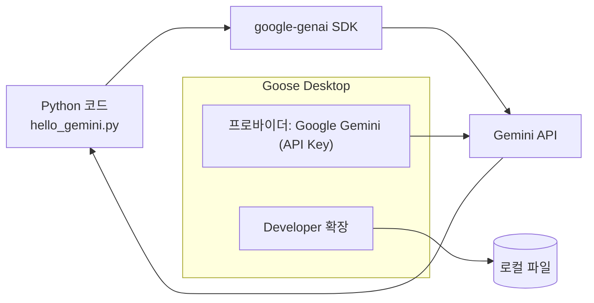

# PART 1. LLM API 및 AI 에이전트 개발 환경 구축 (60분)

실습: L4 Gemini API 첫 호출(`labs/01-gemini-api`), L5 Goose로 문서 통계 도구 만들기(`labs/02-goose-devenv`). 결과물: Gemini API가 연결된 Goose 개발 환경.

## ① 강의 개요

- 학습 목표: Gemini API 키를 환경 변수로 등록해 Python에서 응답을 받고, Goose Desktop에 같은 키와 모델을 연결해 로컬 파일을 읽고 코드를 만들게 한다.
- 필요성: 모델을 직접 만들지 않아도 API로 빌려 쓰면 서비스를 만들 수 있다.
- 전체 과정에서의 역할: 이후 모든 PART가 이 키와 모델 ID(`gemini-3.5-flash-lite`)를 쓴다.

## ② 개념 설명

- **LLM vs AI 에이전트**: LLM은 입력에 답을 만든다. AI 에이전트는 목표를 받아 모델의 판단으로 도구를 골라 실행하고 결과를 반영해 답한다.
- **Google AI Studio**: API 키를 발급하고 모델을 시험하는 웹 도구.
- **무료 등급과 유료 등급**: `gemini-3.5-flash-lite`는 무료 등급에서 요금이 없다. 유료는 입력 $0.30/1M, 출력 $2.50/1M 토큰이다. 무료 등급 입력은 제품 개선에 쓰일 수 있다. 한도 수치는 공식 문서에 표가 없어 https://aistudio.google.com/rate-limit 에서 확인한다.
- **Interactions API와 generateContent**: Interactions API(`client.interactions.create`, google-genai 2.3.0 이상)가 신규 프로젝트에 권장된다. 기존 `generateContent`는 레거시지만 계속 지원된다. `hello_gemini.py --legacy`로 비교할 수 있다.
- **모델 ID**: `.env`의 `DOC_AGENT_MODEL` 한 곳에서 바꾼다. `list_models.py`로 실제 사용 가능 여부를 확인한다.
- **Goose Desktop**: AAIF의 오픈소스 데스크톱 AI 에이전트. Developer 확장이 파일 편집과 셸 명령 실행을 맡는다.

## ③ 아키텍처



## ④ Hands-on

사전 준비와 키 등록은 [README 환경 준비](../../README.md#환경-준비)를 따른다.

### L4 Gemini API 첫 호출 (`labs/01-gemini-api`, 15분)

```
python labs/01-gemini-api/list_models.py
```

```
python labs/01-gemini-api/hello_gemini.py
```

```
python labs/01-gemini-api/check.py
```

기대 결과: `gemini-3.5-flash-lite: available`, `모델 ID: gemini-3.5-flash-lite (Interactions API)`와 3줄 요약, 마지막 줄 `CHECK OK`. 키가 없으면 각 스크립트에 `--mock`을 붙인다.

| 오류 | 해결 |
| --- | --- |
| `GOOGLE_API_KEY가 없습니다` | `.env` 위치와 키 줄 확인 |
| `Gemini API 오류 429` | 무료 한도. 기다리거나 한도 확인 |
| `Gemini API 오류 404` | 모델 ID 오타. `DOC_AGENT_MODEL` 확인 |
| `ModuleNotFoundError: google` | 가상환경 활성화 |

### L5 Goose로 문서 통계 도구 만들기 (`labs/02-goose-devenv`, 20분)

Goose Desktop 연결 순서는 처음 실행 화면에서 **제공업체에 연결** → **Google Gemini (API Key)** → API 키 입력 → **계속** → 모델로 `gemini-3.5-flash-lite` 선택입니다. 화면 그림과 단계별 설명은 [README의 실습 L5](../../README.md#advanced)에 있고, Goose에 줄 프롬프트는 `labs/02-goose-devenv/goose_prompts.md`에 있습니다. 이미 다른 설정으로 쓰고 있었거나 모델이 목록에 없을 때의 방법(Settings → Models → Configure providers, Switch models → Use custom model)은 공식 문서에서 확인한 것이며 화면으로는 확인하지 못했습니다.

```
python labs/02-goose-devenv/doc_stats.py data/samples/project_status_report.md
```

완성본 기준 `글자 수: 519`, `단어 수: 144`, `TODO: 2`, `위험: 3`, `지연: 3`. 막히면 `labs/02-goose-devenv/solution/doc_stats.py`와 비교한다.

```
python labs/02-goose-devenv/check.py
```

Goose Desktop은 이 문서를 쓰는 환경에 설치되어 있지 않아 실행 확인을 하지 못했다.

## ⑤ 실습 확장

**강의 뒤 과제**이다. 강의 시간(300분)에는 소개만 하고, 직접 해 보는 것은 강의가 끝난 뒤에 한다.

- `.goosehints`에 프로젝트 규칙(답변 언어, 금지 동작)을 적어 Goose에 맥락을 준다.
- 모델을 `gemini-3.1-flash-lite` 또는 `gemini-2.5-flash-lite`로 바꿔 본다(`.env`의 `DOC_AGENT_MODEL`, Goose는 모델 선택 화면(목록에 없으면 Use custom model)).
- PART 2의 MCP 서버를 Goose 확장으로도 붙일 수 있음을 예고한다.

## ⑥ 핵심 정리

- API 키는 `.env`의 `GOOGLE_API_KEY` 한 곳에만 둔다.
- 모델 ID는 `.env`의 `DOC_AGENT_MODEL` 한 곳에서 바꾼다.
- Goose는 이미 만들어진 에이전트 앱(개발 보조), ADK는 내 에이전트를 만드는 프레임워크다.
- 다음 PART 2에서 ADK로 에이전트를 직접 만든다.
