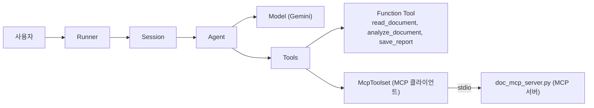

# PART 2. Google ADK 기반 AI 에이전트 개발 (100분)

실습: L6 첫 ADK 에이전트(`labs/03-adk-agent`), L7 문서 분석 Function Tool(`labs/04-function-tools`), L8 MCP 서버로 문서 도구 연결(`labs/05-mcp-tools`). 결과물: 외부 도구를 활용하는 AI 에이전트.

## ① 강의 개요

- 학습 목표: ADK로 Model·Instruction·Tool을 갖춘 에이전트를 만들고, Function Tool과 MCP 서버로 외부 기능을 연결한다.
- 필요성: 프레임워크가 도구 호출 루프, 세션, 이벤트, 개발 UI를 맡으므로 나는 Instruction과 Tool에 집중한다.

## ② 개념 설명

- **구성 요소**: Model, Instruction, Tool, Context(세션·상태).
- **에이전트 루프**: 사용자 입력 → 모델 판단 → 도구 호출 → 결과 반영 → 응답.
- **Agent Framework가 필요한 이유**: 도구 호출 루프, 세션, 이벤트, 개발 UI를 직접 만들지 않아도 된다.
- **ADK**: 설치는 `google-adk[mcp]`. 에이전트 폴더에 `__init__.py`, `agent.py`를 두고 `agent.py`에 `root_agent`를 정의한다. 실행은 `adk run`(터미널)과 `adk web`(개발 UI, 운영용 아님).
- **Function Tool**: 타입 힌트와 docstring을 쓴 Python 함수. 모델은 이 설명을 보고 도구를 고른다.
- **MCP**: 에이전트(호스트)가 외부 도구·데이터(서버)에 표준 방식으로 연결하는 규격. 호스트·클라이언트·서버, Tools·Resources·Prompts, 이 실습은 stdio 전송이다. MCP는 새 AI 모델이 아니라 연결 규격이다.

## ③ 아키텍처



## ④ Hands-on

### L6 첫 ADK 에이전트 (`labs/03-adk-agent`, 15분)

```
adk run labs/03-adk-agent/doc_report_agent
```

폴더 경로를 준다(파일 경로가 아님). 처음 실행하면 `Enable telemetry? [Y/n]`을 물을 수 있다. 문서를 붙여 넣으면 `## 요약`, `## 핵심 항목`, `## 문제점`, `## 보고서` 형식으로 답한다. `labs/03-adk-agent/doc_report_agent/agent.py`의 Instruction을 바꿔 보고, 확인한다.

```
python labs/03-adk-agent/check.py
```

### L7 문서 분석 Function Tool (`labs/04-function-tools`, 25분)

```
adk run labs/04-function-tools/doc_report_agent
```

```
adk web --port 8080 labs/04-function-tools
```

`adk web`(http://localhost:8080)의 이벤트 패널에서 `read_document` -> `analyze_document` -> `save_report`가 보이고 `outputs/<날짜-시각>_<제목>.md`로 저장된다. 코드는 `labs/04-function-tools/doc_report_agent/tools.py`.

```
python labs/04-function-tools/check.py
```

| 오류 | 해결 |
| --- | --- |
| docstring·타입 누락 | 모델이 도구를 고르지 못한다. 추가한다 |
| 경로가 절대 경로 | `data/` 기준 상대 경로(`samples/...`)를 쓴다 |
| 8080 포트 사용 중 | 다른 `adk web`을 끈다 |

### L8 MCP 서버로 문서 도구 연결 (`labs/05-mcp-tools`, 20분)

```
python labs/05-mcp-tools/inspect_mcp.py
```

`MCP 서버 도구 목록:`에 `list_documents`, `read_document`, `read_document 결과: success, 첫 줄 = # 해커톤 팀 킥오프 회의록`, `data/ 밖 요청: error, ...`가 나온다.

```
adk web --port 8080 labs/05-mcp-tools
```

`list_documents` -> `read_document`(MCP 도구) -> `analyze_document` -> `save_report` 순서(모의 모델 기준). 확인:

```
python labs/05-mcp-tools/check.py
```

주의: MCP 서버 실행 명령에는 `sys.executable`을 써서 가상환경 Python이 뜨게 한다. 서버 코드에서 `print`를 하면 stdio 프로토콜이 깨진다. mcp 2.x의 서버 클래스는 `MCPServer`다. 반환형이 dict인 도구의 결과는 TextContent의 JSON 문자열로 오므로 `inspect_mcp.py`는 `json.loads(result.content[0].text)`로 읽는다.

## ⑤ 실습 확장

**강의 뒤 과제**이다. 강의 시간(300분)에는 소개만 하고, 직접 해 보는 것은 강의가 끝난 뒤에 한다.

- 외부 API를 부르는 Function Tool을 추가한다([해커톤 확장 가이드](../hackathon-extension-guide.md)).
- 같은 `doc_mcp_server.py`를 Goose 확장으로 붙여 본다(Goose의 화면 이름은 버전마다 달라 확인하지 못했다).

## ⑥ 핵심 정리

- ADK 에이전트 = Model + Instruction + Tools, 진입 변수는 `root_agent`.
- 도구는 타입 힌트와 docstring이 설명이다.
- MCP 호스트 = ADK 에이전트, 클라이언트 = `McpToolset`, 서버 = `doc_mcp_server.py`.
- 다음 PART 3에서 이 에이전트를 웹 화면에 연결한다.
