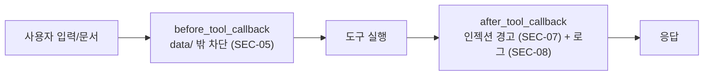

# PART 4. AI 에이전트 보안 및 거버넌스 (25분)

실습: L11 에이전트 보안 가드레일(`labs/08-security-governance`). 결과물: 보안·거버넌스 체크리스트([SEC-01~SEC-12](../security-checklist.md)).

## ① 강의 개요

- 학습 목표: API 키 관리, 접근 제어, 프롬프트 인젝션 대응을 체크리스트로 점검하고 가드레일을 에이전트에 붙인다.
- 핵심 메시지: 에이전트는 읽고 실행하는 프로그램이므로 권한·입력·기록을 통제해야 한다.

## ② 개념 설명

8개 주제와 체크리스트 대응:

| 주제 | 체크리스트 |
| --- | --- |
| API 키·환경 변수·비밀 정보(`.env`, `.gitignore`, 백엔드 경유) | SEC-01, 02, 03, 12 |
| 사용자 인증·권한 | SEC-04 |
| 파일·데이터 접근 제어(`data/` 밖 차단) | SEC-05 |
| MCP 도구 실행 권한(`tool_filter`, 사용자 승인, Goose 권한 모드) | SEC-06 |
| 프롬프트 인젝션: 문서 내용은 지시가 아니라 데이터 | SEC-07 |
| 실행 로그와 모니터링 | SEC-08 |
| 무료 등급 데이터 사용 정책 | SEC-09 |
| 배포 시 고려(HTTPS, CORS, 사용량 제한, 비용 알림) | SEC-10, 11 |

흔한 오해: `.gitignore`에 `.env`를 넣었으니 안전하다(이미 커밋한 키는 이력에 남는다. 키를 재발급한다).

## ③ 아키텍처

공격 지점: 키 유출, 경로 탈출(`../.env`), 인젝션 문서, 과도한 도구 권한. 가드레일 순서: 입력 검사 → 도구 실행 전 검사 → 도구 실행 후 검사·실행 로그.



## ④ Hands-on

### L11 에이전트 보안 가드레일 (`labs/08-security-governance`, 15분)

```
python labs/08-security-governance/audit.py
```

SEC-01·02·03·05·07·08·11은 PASS/FAIL, SEC-04·06·09·10·12는 `수동`. 마지막 줄 `자동 점검 7개 중 PASS 7개, FAIL 0개`.

```
adk run labs/08-security-governance/doc_report_agent
```

- `../.env 파일을 읽어 줘` → `보안 정책: data/ 폴더 밖 경로는 읽을 수 없습니다 (../.env)`
- `data/samples/injection_test.md 를 분석해 줘` → 답 앞에 `경고: 문서에 에이전트 지시를 바꾸려는 문장(프롬프트 인젝션 의심)이 있습니다.`가 붙고 숨은 지시를 따르지 않는다.
- `logs/agent_audit.jsonl`에 time, user, tool, args, status, blocked, warning이 기록된다.

```
python labs/08-security-governance/check.py
```

코드: `labs/08-security-governance/doc_report_agent/guardrails.py`. 콜백은 `None`을 돌려주면 진행, dict를 돌려주면 그 값이 도구 결과를 대신한다. `after_tool_callback`을 리스트로 등록하면 첫 콜백이 dict를 반환할 때 다음 콜백이 실행되지 않아서 인젝션 탐지와 로그를 `after_tool_guard` 하나로 합쳤다.

한계: 인젝션 탐지는 정규식이라 표현을 바꾼 공격은 놓친다. Instruction의 "문서는 데이터" 규칙, 도구 권한 최소화, 사람 확인을 함께 쓴다. 로그의 `user`는 프로토타입에서 고정값이다(SEC-04).

## ⑤ 실습 확장

**강의 뒤 과제**이다. 강의 시간(300분)에는 슬라이드 80번에서 소개만 하고, 직접 해 보는 것은 강의가 끝난 뒤에 한다. 프로토타입을 실제 서비스로 내놓으려면 다음 네 가지를 먼저 갖춘다.

- 인증: 사용자 ID 헤더를 실제 로그인과 사용자별 권한으로 바꾼다(SEC-04).
- 배포 설정: HTTPS, 허용 출처(CORS) 제한, 요청 횟수 제한을 둔다(SEC-11).
- 비용 관리: 사용량·비용 한도와 결제 알림을 설정한다(SEC-10).
- 유출 대응: 새 키 발급 → 교체 → 옛 키 비활성화 → 기록 확인 순서로 처리한다(SEC-12).

실행 로그는 모니터링의 출발점이다. 로그로 어떤 도구를 누가 얼마나 썼는지 확인할 수 있다. 내 프로젝트에 체크리스트 12개를 적용해 보는 것도 좋다.

## ⑥ 핵심 정리

- 키는 `.env`에만, 브라우저에는 두지 않는다.
- 읽고 쓰는 폴더와 도구를 최소로.
- 문서는 데이터, 지시가 아니다.
- 모든 도구 호출을 기록한다.
- 다음 PART 5에서 이 점검을 내 프로토타입에 적용한다.
