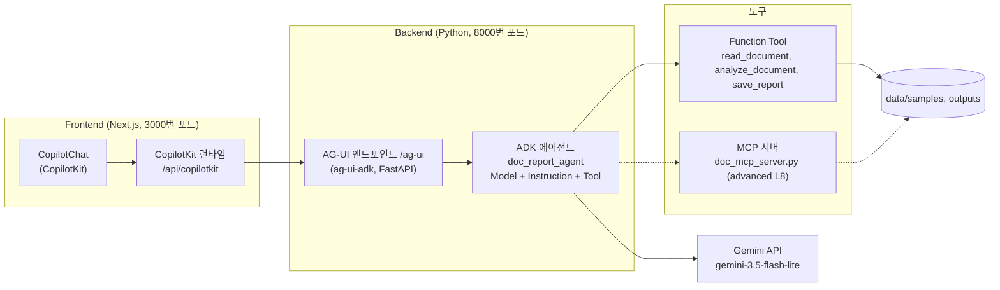
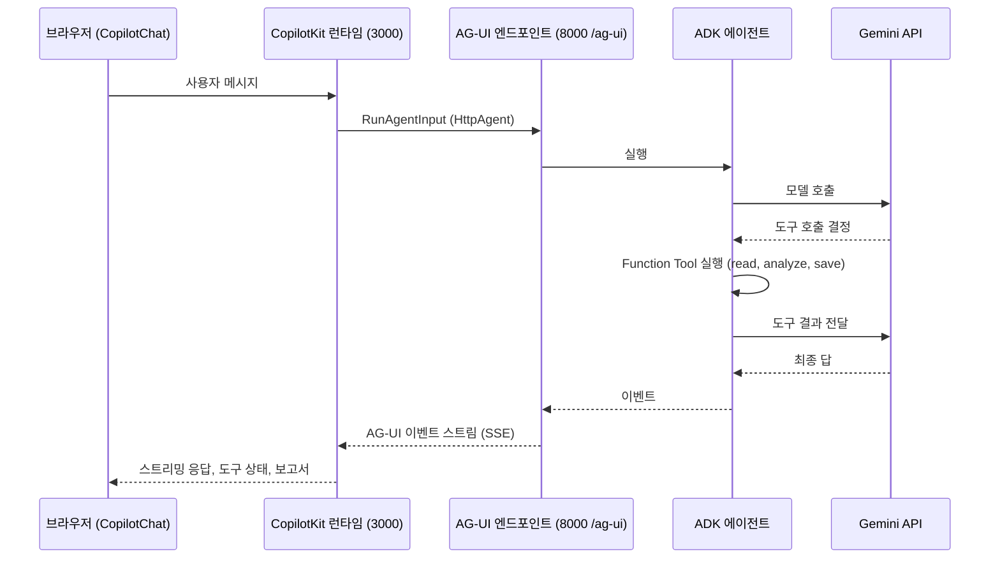
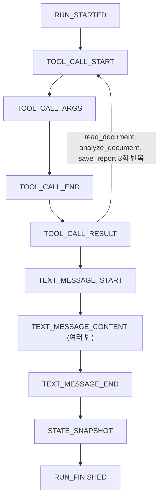
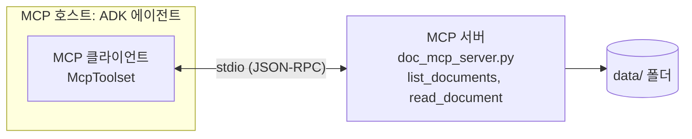

# 기술 아키텍처

구성 요소 이름은 슬라이드와 같다. 다이어그램은 Mermaid로 쓴 것이라 GitHub 등 Mermaid를 지원하는 화면에서 그림으로 보인다.

## 1. 4계층 전체 구조

모델(Gemini) – 에이전트(ADK) – 도구(Tool·MCP) – 프론트엔드(AG-UI·CopilotKit).

API 키는 Backend 쪽에만 있다. 브라우저는 Gemini를 직접 부르지 않는다(SEC-03).

## 2. 호출 흐름 (한 번의 대화)

## 3. AG-UI 이벤트 순서

L9 `send_run.py`가 출력하는 모의 모델 기준 순서다. 실제 모델은 도구 호출 전에 `TEXT_MESSAGE_*`를 먼저 보낼 수 있다.

| 이벤트 | 의미 | 화면에서 쓰이는 곳 |
| --- | --- | --- |
| `RUN_STARTED` / `RUN_FINISHED` | 실행의 시작과 끝(Lifecycle) | 로딩 표시 |
| `TEXT_MESSAGE_START/CONTENT/END` | 답 글자를 조각 단위로 전달 | 스트리밍 응답 |
| `TOOL_CALL_START/ARGS/END/RESULT` | 도구 호출과 결과 | 도구 상태 카드 |
| `STATE_SNAPSHOT` | 공유 상태 | (이 실습에서는 보고서 패널 보조) |

SSE로 전송되는 `type` 값은 대문자 스네이크 케이스(`RUN_STARTED`)다. 공식 이벤트 문서의 PascalCase 이름(RunStarted)은 개념 이름이다. 도구 이름은 `toolCallName`, 글자 조각은 `delta`에 담긴다.

## 4. MCP 구조 (advanced L8)

서버는 에이전트가 하위 프로세스로 띄우고 표준 입출력으로 대화한다. `tool_filter`로 열 도구를 제한한다(SEC-06).

## 5. 프로토콜의 층

| 프로토콜 | 연결 대상 | 시작 |
| --- | --- | --- |
| AG-UI | 에이전트 ↔ 사용자 화면 | CopilotKit과 LangChain·CrewAI의 협력에서 출발한 오픈 프로토콜 |
| MCP | 에이전트 ↔ 도구·데이터 | Anthropic |
| A2A | 에이전트 ↔ 에이전트 | Google |

CopilotKit은 AG-UI를 쓰는 프론트엔드 프레임워크이고 AG-UI 자체가 아니다. 출처는 [기술 검증 결과](tech-verification.md)에 있다.
