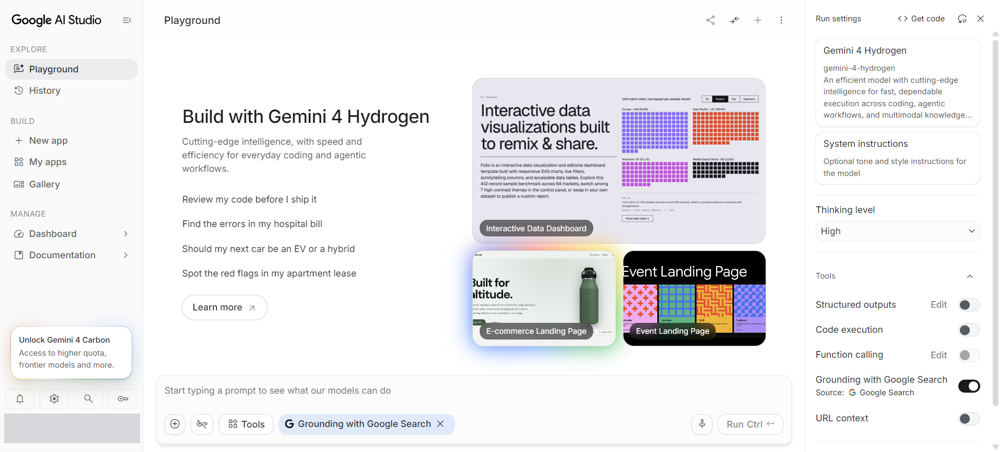
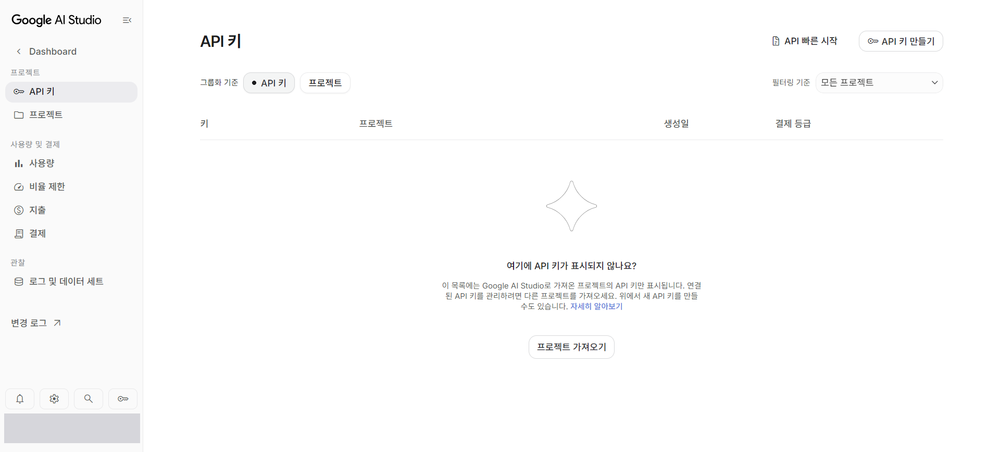
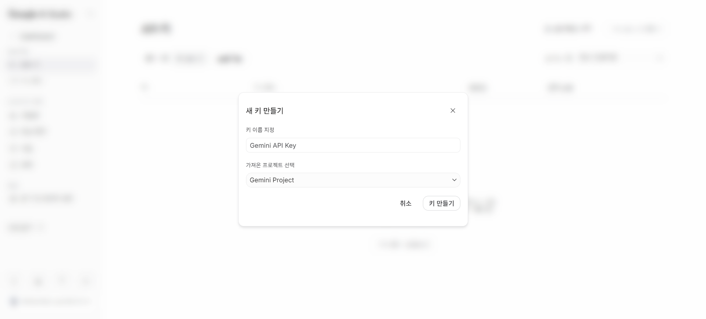
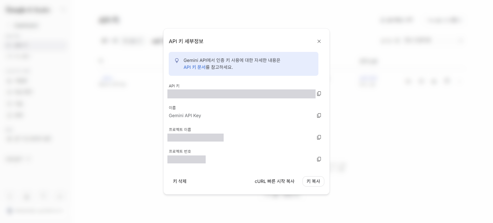
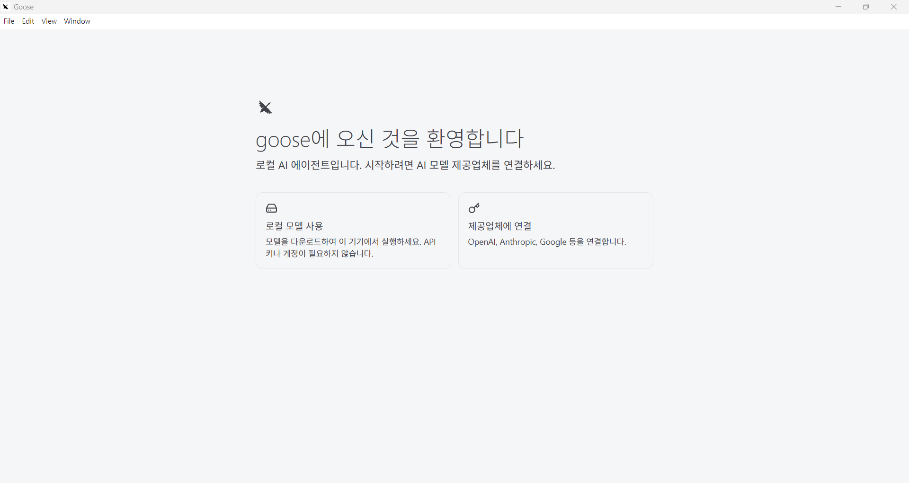
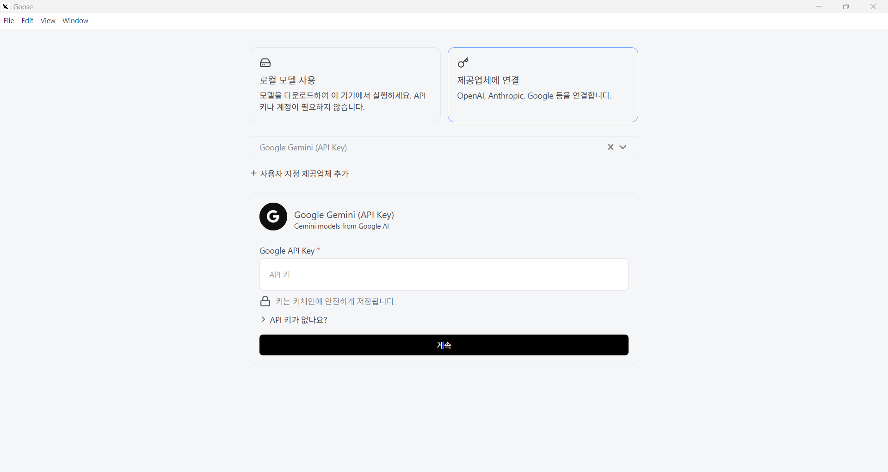
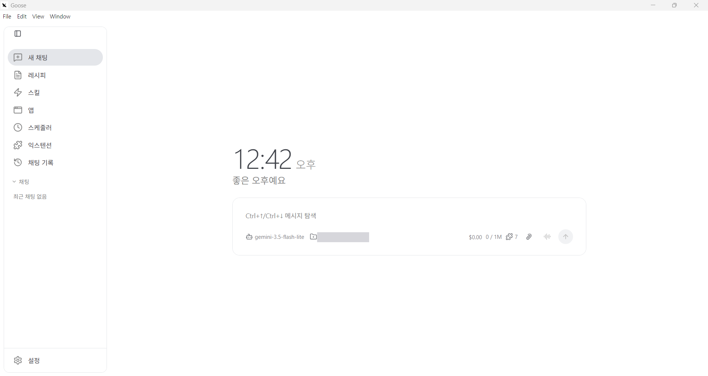
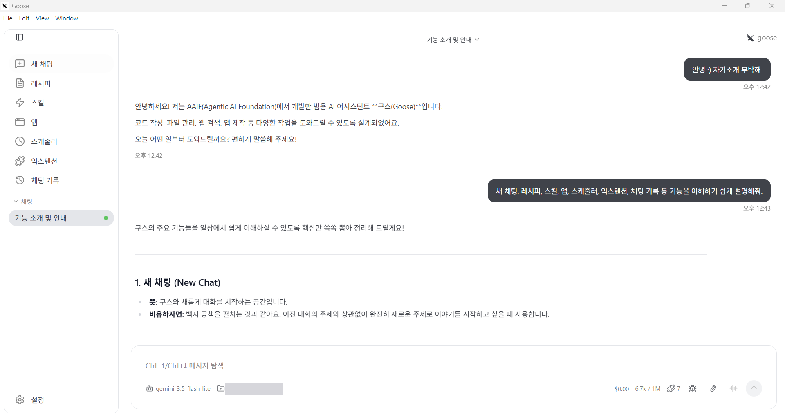

# 참여자용 사전 준비 가이드

강의가 시작되기 전에 이 가이드대로 준비를 끝내 주세요. basic 트랙은 강의 중에 설치를 하지 않습니다. 준비에는 약 30~60분이 걸립니다(`npm install`에 약 5분 포함).

이 가이드는 [README](../README.md)의 "환경 준비"를 더 자세히 풀어 쓴 것입니다. 명령은 README와 같습니다.

## 체크리스트

- [ ] Python 3.12 설치(3.11~3.13 허용)
- [ ] Node.js 22 LTS 이상 설치(최소 20.9)
- [ ] Git 설치
- [ ] Goose Desktop 설치
- [ ] Google AI Studio에서 API 키 발급
- [ ] 저장소 받기, 가상환경 만들기, 패키지 설치
- [ ] `.env` 파일 작성
- [ ] Frontend 패키지 설치(`npm install`)
- [ ] 점검 명령 실행
- [ ] (advanced 또는 Goose 시연을 직접 해 보실 분) Goose Desktop에 Gemini 연결

## 1. Python, Node.js, Git 설치

각 프로그램의 공식 사이트에서 설치 파일을 내려받아 설치하세요. Python은 3.12를 권장합니다. 3.14는 호환을 확인하지 못해 쓰지 않습니다. Node.js는 22 LTS 이상을 권장합니다. Node.js는 화면(Frontend)을 실행하는 데 필요하고, Git은 저장소를 내려받는 데 필요합니다.

설치가 끝났다면 새 터미널을 열어 다음 명령으로 확인하세요. **터미널**은 글자로 명령을 입력해 컴퓨터에 일을 시키는 창입니다. Windows는 시작 메뉴에서 PowerShell을 검색해 실행하고, macOS는 Spotlight에서 터미널을 검색해 실행합니다.

```
python --version
node --version
npm --version
git --version
```

각 명령이 버전 숫자를 보여 주면 설치된 것입니다.

- Windows에서 `python`을 찾을 수 없다고 나오면, 설치할 때 PATH 추가 옵션을 켰는지 확인하세요. PATH는 컴퓨터가 명령을 찾는 경로 목록입니다.
- macOS에서 `python`을 찾을 수 없다고 나오면 `python3`만 설치되어 있을 수 있습니다. 이 경우 아래 4번에서 `python3 -m venv .venv`로 가상환경을 만드세요. 이 방법은 macOS에서 직접 확인하지 못했습니다.

## 2. Goose Desktop 설치

설치 방법은 https://goose-docs.ai/docs/getting-started/installation 에 있습니다.

- Windows: `Goose-win32-x64-setup.exe`(현재 사용자 설치, 관리자 권한 불필요) 또는 ZIP 파일
- macOS: Apple Silicon은 `Goose.zip`, Intel은 `Goose_intel_mac.zip`, 또는 `brew install --cask block-goose`

설치한 뒤 한 번 실행해서 창이 열리는지만 확인하세요. Gemini 연결은 6번에서 합니다.

## 3. Gemini API 키 발급

**Google AI Studio**는 Gemini API 키를 발급하고 모델을 시험해 보는 Google의 웹 사이트입니다. **API 키**는 Gemini를 호출할 권한을 증명하는 비밀 문자열입니다. 비밀번호처럼 다루세요. 채팅창, 코드, 스크린샷에 붙여 넣지 마세요.

아래 화면은 사용자가 제공한 실제 화면(2026-11-15 캡처)입니다. 키와 프로젝트 정보는 가려 두었습니다. 화면 언어와 모양은 계정과 시기에 따라 다를 수 있습니다.

1. 브라우저에서 https://aistudio.google.com 을 열고 Google 계정으로 로그인합니다.

   

2. 왼쪽 아래의 **열쇠 아이콘**을 누릅니다. 주소가 `aistudio.google.com/api-keys`인 API 키 화면으로 이동합니다.
3. 오른쪽 위의 **API 키 만들기** 버튼을 누릅니다.

   

4. **새 키 만들기** 창에서 **키 이름 지정**에 알아보기 쉬운 이름(예: Gemini API Key)을 적고, **가져온 프로젝트 선택**에서 프로젝트를 고른 뒤 **키 만들기**를 누릅니다.

   

5. **API 키 세부정보** 창에서 **키 복사** 버튼을 눌러 키를 복사합니다. 아래 그림에서는 키가 회색 상자로 가려져 있지만, 실제 화면에는 키가 보입니다.

   

키가 유출되면 새 키를 발급하고, `.env`의 키를 바꾸고, 옛 키를 비활성화한 뒤 사용 기록을 확인하세요.

무료 등급에 넣은 입력은 제품 개선에 쓰일 수 있으므로 실제 민감 문서를 넣지 마세요. 무료 등급의 요청 한도 숫자는 공식 문서에 표가 없어 적지 않았습니다. 내 프로젝트의 한도는 https://aistudio.google.com/rate-limit 에서 확인하세요. 한국에서 무료 등급을 쓸 수 있는지는 확인하지 못했으므로, 아래 5번의 `hello_gemini.py`를 미리 실행해 보세요.

## 4. 저장소 받기, 가상환경, 패키지 설치

### 저장소 받기

저장소는 이 강의의 파일을 모아 둔 폴더 전체입니다. 강사가 알려 준 주소에서 저장소를 내려받거나(또는 강사가 준 ZIP 파일을 풀어) `hands-on-ai-agent-platform` 폴더를 준비하세요. 터미널에서 내려받는다면 다음 한 줄을 실행합니다. `<...>` 부분은 강사가 알려 준 주소로 바꿔 입력하세요.

```
git clone <강사가 알려 준 주소>
```

이 명령은 저장소를 둘 폴더(예: 문서 폴더)에서 실행하세요. 명령을 실행한 폴더 안에 `hands-on-ai-agent-platform` 폴더가 새로 생깁니다.

### 저장소 최상위 폴더로 이동

이 가이드의 명령은 **저장소 최상위 폴더**에서 실행합니다. 저장소 최상위 폴더는 `README.md`, `labs` 폴더, `requirements.txt`가 보이는 폴더입니다. 터미널에서 `cd` 뒤에 폴더 경로를 적어 이동하세요. 터미널을 새로 열 때마다 다시 이동해야 합니다.

```
cd <저장소 최상위 폴더의 경로>
```

### 가상환경 만들기

**가상환경**은 이 강의에 필요한 패키지를 다른 프로젝트와 섞이지 않게 따로 담아 두는 폴더입니다. 먼저 만듭니다.

```
python -m venv .venv
```

macOS에서 `python`을 찾을 수 없다면 `python3 -m venv .venv`로 만드세요. 아래에서 가상환경을 활성화한 뒤에는 `python` 명령을 그대로 쓸 수 있습니다(macOS에서는 직접 확인하지 못했습니다).

### 가상환경 활성화

가상환경은 만든 뒤 **활성화**해야 쓸 수 있습니다. 터미널 종류에 맞는 명령 하나만 실행하세요. 새 터미널을 열 때마다 다시 활성화해야 합니다.

Windows PowerShell:

```
.venv\Scripts\Activate.ps1
```

Windows 명령 프롬프트(cmd):

```
.venv\Scripts\activate.bat
```

macOS:

```
source .venv/bin/activate
```

입력줄 맨 앞에 `(.venv)`가 보이면 활성화된 것입니다.

PowerShell에서 `이 시스템에서 스크립트를 실행할 수 없으므로`라는 오류가 나면, PowerShell이 스크립트 실행을 막아 둔 것입니다. 다음 명령을 한 번 실행하세요. 현재 사용자에게만 적용되는 설정입니다. 확인 질문이 나오면 `Y`를 입력하고 Enter를 누른 뒤, 위의 PowerShell용 활성화 명령을 다시 입력하세요.

```
Set-ExecutionPolicy -Scope CurrentUser -ExecutionPolicy RemoteSigned
```

다른 방법으로, 명령 프롬프트(cmd) 창을 새로 열어 cmd용 명령을 입력해도 됩니다. PowerShell 창 안에서 `activate.bat`을 실행하면 활성화되지 않으니 주의하세요.

### 패키지 설치

필요한 패키지를 한꺼번에 설치합니다(약 96초 걸렸습니다).

```
pip install -r requirements.txt
```

### `.env` 파일 작성

견본 파일 `.env.example`을 복사해 `.env`를 만듭니다. Windows는 `copy .env.example .env`, macOS는 `cp .env.example .env`입니다. 그다음 편집기(메모장 등)로 `.env`를 열어 `GOOGLE_API_KEY=` 뒤에 3번에서 복사한 키를 붙여 넣고 저장하세요. 따옴표는 붙이지 않습니다. `.env`는 `.gitignore`에 들어 있어 저장소에 올라가지 않습니다.

### Frontend 패키지 설치

화면(Frontend)에 필요한 패키지를 설치합니다. 처음 한 번만 하면 되지만 약 5분 걸립니다.

```
npm --prefix labs/07-copilotkit-frontend install
```

## 5. 점검 명령

저장소 최상위 폴더의 터미널(가상환경 활성화)에서 실행하세요.

```
python labs/01-gemini-api/check.py
```

`CHECK OK`가 나오면 Python 환경이 준비된 것입니다. 이 확인은 키가 없어도 통과합니다. 키가 동작하는지는 다음 명령으로 확인하세요.

```
python labs/01-gemini-api/hello_gemini.py
```

`모델 ID: gemini-3.5-flash-lite (Interactions API)`와 3줄 요약이 나오면 됩니다. `429`가 나오면 무료 등급의 사용량 제한이고, `404`가 나오면 모델 ID가 틀린 것입니다. 키가 없다면 명령 끝에 `--mock`을 붙이세요.

## 6. Goose Desktop에 Gemini 연결 (advanced, 또는 직접 해 볼 분)

basic 트랙에서는 강사가 Goose를 시연하므로 이 단계는 선택입니다. advanced 트랙에서는 PART 1의 실습 L5에서 이 연결을 쓰므로 미리 해 두면 좋습니다. 아래 화면은 사용자가 제공한 실제 화면(2026-11-15 캡처)입니다. 3번에서 복사한 API 키가 필요합니다.

1. Goose Desktop을 처음 실행하면 "goose에 오신 것을 환영합니다" 화면이 나옵니다. **제공업체에 연결**을 누릅니다.

   

2. 목록에서 **Google Gemini (API Key)**를 고르고, **Google API Key** 칸에 키를 붙여 넣은 뒤 **계속**을 누릅니다. 화면에 "키는 키체인에 안전하게 저장됩니다"라고 나옵니다.

   

3. 키를 연결한 뒤 모델로 `gemini-3.5-flash-lite`를 선택하세요. 연결이 끝나면 채팅 화면이 나오고, 입력창 아래에 모델 이름과 작업 폴더가 보입니다.

   

4. 한국어로 말을 걸어 답이 오면 연결이 된 것입니다.

   

이미 다른 설정으로 Goose를 쓰고 있었거나 모델 목록에 `gemini-3.5-flash-lite`가 보이지 않으면, 공식 문서(https://goose-docs.ai/docs/getting-started/providers)에 따라 **Settings** → **Models** → **Configure providers**에서 프로바이더를 고르고, **Switch models** → **Use custom model**에 모델 ID를 입력하세요. 이 방법은 공식 문서에서 확인한 것이며 화면으로는 확인하지 못했습니다.

## 막혔을 때

[README의 문제 해결](../README.md#문제-해결)을 먼저 보세요.
