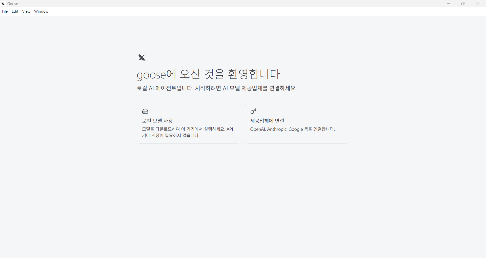
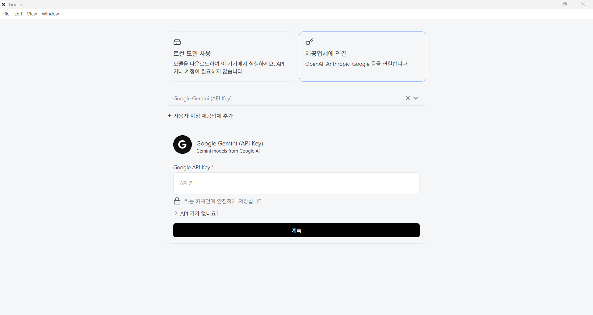
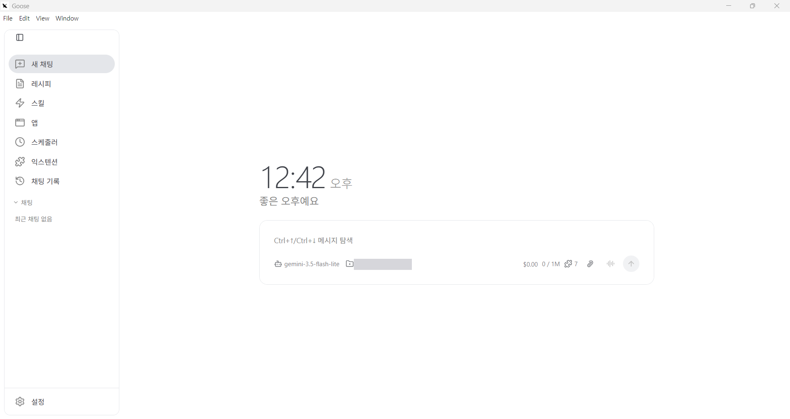
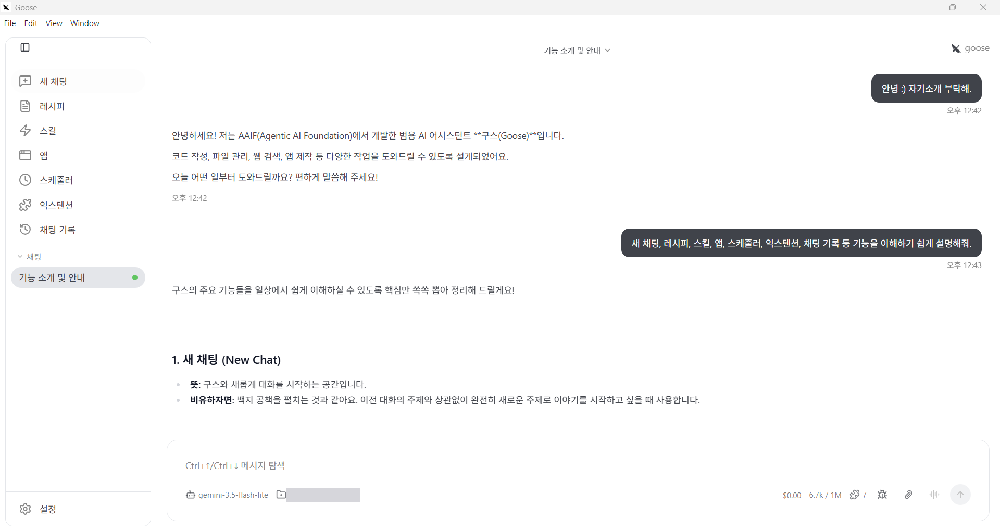

# L5 Goose로 문서 통계 도구 만들기

이 실습(advanced 트랙의 실습 5)에서는 Goose Desktop에 Gemini를 연결합니다. Goose Desktop은 내 컴퓨터에서 파일을 읽고 명령을 실행해 주는 오픈소스 데스크톱 AI 에이전트입니다(이후 "Goose"라고 부릅니다). Goose에게 샘플 문서를 읽히고, 문서 통계 스크립트(`doc_stats.py`)를 만들어 실행하게 합니다.

## 1. Goose Desktop에 Gemini 연결

Goose는 혼자서는 답을 만들지 못하고, 연결한 AI 모델 서비스를 빌려 씁니다. 이 서비스를 Goose 화면에서는 "제공업체"라고 부릅니다(이 강의의 다른 자료에서 쓰는 "프로바이더"와 같은 말입니다). 여기서는 Gemini API 키로 Google Gemini를 연결합니다. 아래 절차와 그림은 Goose를 처음 실행했을 때의 한국어 화면 기준입니다.

1. Goose를 처음 실행하면 "goose에 오신 것을 환영합니다" 화면이 나옵니다. 두 카드 중 **제공업체에 연결**을 누르세요. **로컬 모델 사용**은 모델을 내 컴퓨터에 내려받아 쓰는 방법이라 이 실습에서는 쓰지 않습니다.

   

2. 제공업체 목록에서 **Google Gemini (API Key)**를 고르세요.
3. **Google API Key** 칸에 Gemini API 키를 붙여 넣으세요. `.env`의 `GOOGLE_API_KEY`에 넣은 것과 같은 값입니다. 화면 안내대로 키는 키체인(운영체제가 비밀번호를 안전하게 보관하는 저장소)에 저장됩니다.
4. **계속**을 누르세요.

   

5. 키를 연결한 뒤 모델로 `gemini-3.5-flash-lite`를 선택하세요.
6. 채팅 화면이 나오면 입력창 아래를 확인하세요. 모델 이름 `gemini-3.5-flash-lite`가 보이면 연결된 것입니다. 그 옆 폴더 아이콘에는 Goose가 파일을 읽고 쓰는 작업 폴더가 표시됩니다. 작업 폴더가 이 저장소의 최상위 폴더인지 확인하세요. 작업 폴더를 바꾸는 화면은 스크린샷으로 확인하지 못했습니다.

   

7. 입력창에 `안녕 :) 자기소개 부탁해.`처럼 한국어로 물어보세요. 답이 오면 연결이 끝난 것입니다.

   

Goose가 파일을 편집하고 터미널 명령을 실행하는 일은 Developer 확장(Goose에 기본으로 들어 있는 확장)이 맡습니다. 공식 문서에 따르면 설치할 때 기본으로 켜져 있습니다. 왼쪽 사이드바의 **익스텐션** 메뉴에서 확장을 관리합니다.

### 이미 다른 설정으로 쓰고 있었거나 모델이 목록에 없을 때

처음 실행 화면이 나오지 않거나(이미 다른 제공업체로 설정한 경우), 모델 목록에 `gemini-3.5-flash-lite`가 없으면 설정 화면에서 바꾸세요. 아래 절차는 공식 문서(goose-docs.ai의 providers 페이지)로만 확인했고 스크린샷으로는 확인하지 못했습니다. 메뉴 이름은 공식 문서의 영어 표기입니다. 한국어 화면에서는 번역된 이름으로 보일 수 있습니다(사이드바의 **설정**은 스크린샷으로 확인했습니다).

1. 왼쪽 사이드바 맨 아래의 **설정**을 누르세요.
2. **Models** 탭에서 **Configure providers**를 누르세요.
3. 목록에서 Google Gemini를 고르고 **Configure**를 누른 뒤, API 키를 넣고 **Submit**을 누르세요.
4. **Switch models** → Google Gemini → **Use custom model**을 고르세요.
5. `gemini-3.5-flash-lite`를 입력하고 **Select model**을 누르세요.

터미널용 명령인 `goose configure`는 직접 입력한 모델 이름을 받지 않습니다. 모델 이름을 직접 입력해야 하면 Desktop 화면에서 설정하세요.

## 2. 맥락 파일(.goosehints)

`.goosehints`는 Goose가 대화할 때마다 참고하는 프로젝트 안내 파일입니다. 이 폴더의 [.goosehints](.goosehints)는 예시입니다. 저장소 최상위 폴더에 복사하면 Goose가 이 규칙을 따릅니다. 터미널에서 저장소 최상위 폴더에 있는 상태로, 운영체제에 맞는 명령 하나를 입력하세요.

macOS:

```
cp labs/02-goose-devenv/.goosehints .goosehints
```

Windows:

```
copy labs\02-goose-devenv\.goosehints .goosehints
```

## 3. Goose에게 시키기

[goose_prompts.md](goose_prompts.md)의 프롬프트를 순서대로 하나씩 Goose 채팅 창에 붙여 넣으세요. Goose가 파일을 만들거나 명령을 실행하기 전에, 무엇을 하려는지 읽고 확인한 뒤 허락하세요.

## 4. 실행과 확인

터미널에서 저장소 최상위 폴더에 있는 상태로 진행합니다.

1. Goose가 만든 스크립트를 실행하세요.

   ```
   python labs/02-goose-devenv/doc_stats.py data/samples/project_status_report.md
   ```

2. 자동 확인을 실행하세요.

   ```
   python labs/02-goose-devenv/check.py
   ```

`check.py`는 `labs/02-goose-devenv/doc_stats.py`가 있으면 그 파일을 검사합니다. 없으면 완성본인 `solution/doc_stats.py`를 검사합니다. 완성본의 출력은 다음과 같습니다.

```
파일: project_status_report.md
글자 수: 519
단어 수: 144
제목:
  # 스마트 배송 앱 프로젝트 주간 현황 보고
  ## 1. 진행 요약
  ## 2. 완료한 일
  ## 3. 이슈와 위험
  ## 4. 다음 주 계획
키워드:
  TODO: 2
  위험: 3
  지연: 3
```

Goose가 만든 파일은 출력 형식이 조금 다를 수 있습니다. `check.py`가 실패하면 빠진 항목을 알려 줍니다. 그 항목을 추가해 달라고 Goose에게 다시 요청하세요. 그래도 막히면 `solution/doc_stats.py`와 비교해 보세요.

## 주의

- Goose는 터미널 명령을 직접 실행할 수 있습니다. 실행 전에 확인을 받을지는 Goose 설정의 권한 모드에서 정합니다. 실습 중에는 명령을 직접 확인하는 모드를 권장합니다(SEC-06).
- 무료 등급에 넣은 입력은 Google의 제품 개선에 쓰일 수 있습니다. 실제 민감 문서를 Goose에 넣지 마세요(SEC-09).
